<div align="center">


# XStats

**System monitoring and everyday Mac tools, with a full app window and menu bar access.**

See CPU, memory, network and temperature at a glance, and open the details for trends and app usage. Enable tools such as AI, calendar and fan control when you need them.

[](https://github.com/ysicing/xstats/releases)
[](https://github.com/ysicing/xstats/actions/workflows/ci.yml)
[](https://github.com/ysicing/xstats/releases)
[](LICENSE)
[](https://twitter.com/YsiCing)

[Download the latest release](https://github.com/ysicing/xstats/releases) · [Features](#features) · [Install](#install) · [Data and privacy](#data-and-privacy) · [Changelog](CHANGELOG.md)

[简体中文](README.md) · **English** · [日本語](README.ja.md) · [한국어](README.ko.md)

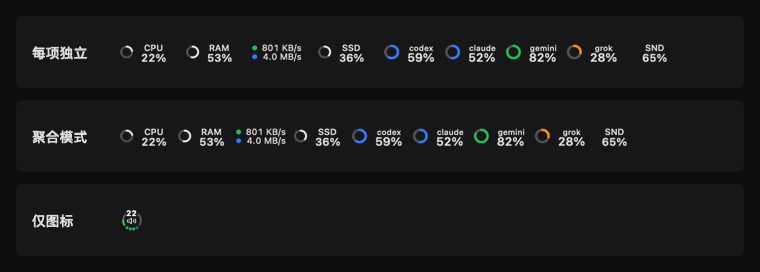

</div>

Accounts, addresses, processes, metrics, usage and cleanup results in screenshots are demo data. The main window’s Mac model and hardware capabilities come from read-only information on this Mac; support varies by model.

## Install

Requires an **Apple silicon Mac with macOS 14 or later**.

Download the DMG from [GitHub Releases](https://github.com/ysicing/xstats/releases) and drag XStats into Applications. XStats checks for updates, and you decide whether to install them.

Or install with Homebrew:

```bash
brew tap ysicing/tap
brew trust ysicing/tap
brew install --cask xstats
```

## Features

XStats is a free, open-source native app built with Swift, AppKit and SwiftUI. No account is required.

### Menu bar and optional features

Show metrics **separately**, in **Aggregated Mode**, or as **a three-in-one icon** with freely combined sources. Customize items, order and styles, and open metric details from the overview. Choose standard or hand-drawn app artwork, with live status available in the Dock.

Enable monitoring and tools as needed, and configure menu bar entries separately. Hiding an entry leaves the feature running. Disabling monitoring stops live collection, related alerts and new history while keeping existing records.

<p align="center">
  <picture>
    <source media="(prefers-color-scheme: dark)" srcset="Assets/readme/combined-overview-zh-Hans-dark.png">
    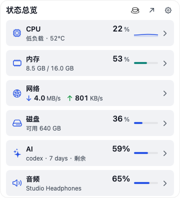
  </picture>
</p>

### System monitoring

| Module | Details |
|---|---|
| **CPU** | Overall and per-core utilization, load, frequency and temperature |
| **GPU** | Graphics utilization, temperature and power |
| **Memory** | Memory pressure, usage breakdown and swap |
| **Disk** | Capacity, read/write rates, per-app I/O and SMART health |
| **Network** | Upload/download rates, interfaces and connection summary |
| **Energy** | Temperatures, power, app energy, battery and Bluetooth device charge |
| **Fans** | Fan speeds and adjustment on supported Macs |
| **Displays** | Resolution, refresh rate and DDC/CI external display controls |
| **System info** | Mac, macOS, Apple Intelligence status and on-device model storage |

Frequency, temperature and power readings depend on what the Mac model and macOS expose.

<p align="center">
  <picture>
    <source media="(prefers-color-scheme: dark)" srcset="Assets/readme/overview-dark.png">
    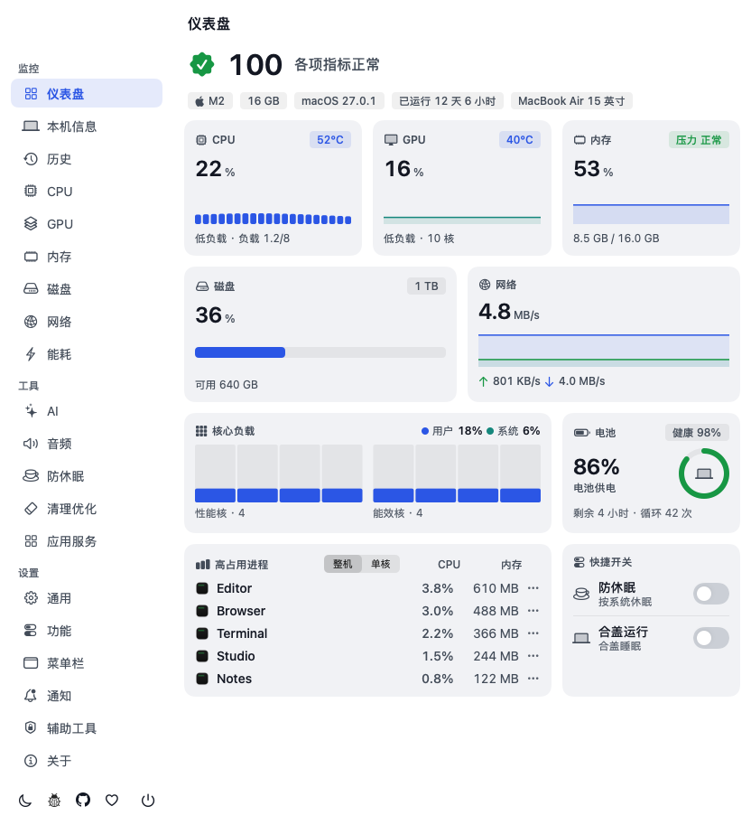
  </picture>
</p>

###  Network Monitor

**Optional on macOS 15+, disabled by default, and requires a separate network component.** Explore newly observed connections, map destinations and upload/download trends by app, process, domain or region.

Observation is read-only: all traffic is allowed and communication content is never inspected. Collection runs only while the page is visible and not paused; the last 15 minutes of history stay on this Mac and can be cleared. The map database downloads on first use, then works offline. Locations represent areas, not precise device positions.

<p align="center">
  <picture>
    <source media="(prefers-color-scheme: dark)" srcset="Assets/readme/connections-zh-Hans-dark.png">
    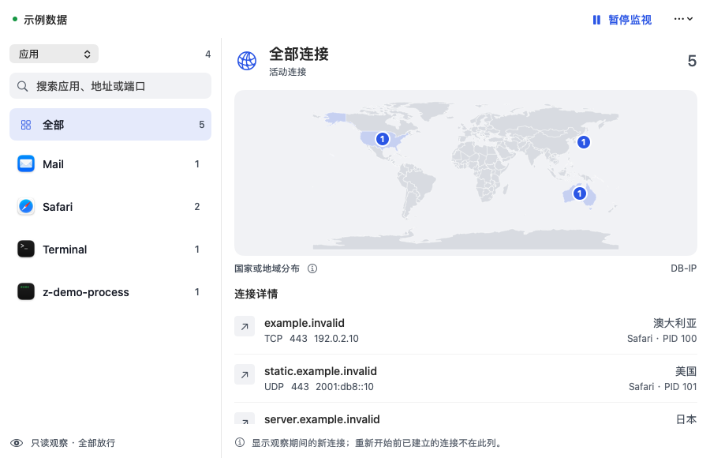
  </picture>
</p>

### AI

Install and run [Magpie](https://usemagpie.ai) to track AI service usage from the menu bar:

- **Usage trends**: tokens, requests, generation speed and estimated USD costs. Estimates are not subscription bills.
- **Subscription accounts**: plans, quota usage and reset times.

AI usage supports Magpie’s local API exclusively. Only requests routed through Magpie count toward token usage.

### Tools

Command Bar, Launchpad and new documents in Finder are experimental features, each enabled independently.

| Tool | Description |
|---|---|
| **Command Bar** | Search apps, files and actions; look up processes, ports and packages |
| **Launchpad** | **macOS 26+ only**; grid, list, categories, folders and custom app layouts |
| **Finder documents** | Create text, Office and iWork documents from the context menu |
|  **XStats Capture** | Annotate and redact screenshots locally, record with audio; also a [standalone app](https://github.com/ysicing/XStats/releases/tag/capture-v0.1.12) |
| **Fan control** | Switch between automatic and manual control on supported Macs |
| **Keep awake** | Keep the system or display awake, including with the lid closed |
| **Apps & Services** | Manage apps, Homebrew packages, startup items and services |
| **Clean & Optimize** | Review caches and build artifacts, with optional Mole support · [Scope](docs/CLEANUP.md) |
| **Diagnostics** | Speed, DNS, egress, public IP, connectivity and WebRTC / DNS leak tests |
| **Calendar** | Chinese lunar dates, holidays, make-up workdays, almanac, events and reminders |
| **Audio** | Volume and device switching; per-app volume and output on macOS 14.4+ |
| **Timers** | Countdown, Pomodoro, stopwatch, break reminders and local focus statistics |
| **Process manager** | Search, sort, group by app and end processes |

### Integrations

- **Desktop widgets**: system overview, AI quotas and tokens, calendar, timers, time zones and network information.
- **Languages**: 简体中文, 繁體中文, English, 日本語, 한국어, Deutsch, Español, Français, العربية.
- **Deep links**: open common views from launchers, Shortcuts or the terminal · [Protocol](docs/DEVELOPMENT.md#xstats-深链).

<p align="center">
  <picture>
    <source media="(prefers-color-scheme: dark)" srcset="Assets/readme/widgets-zh-Hans-dark.png">
    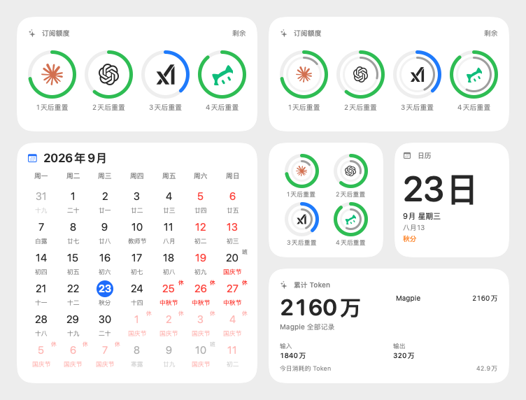
  </picture>
</p>

<details>
<summary>More screenshots</summary>

<p align="center">
  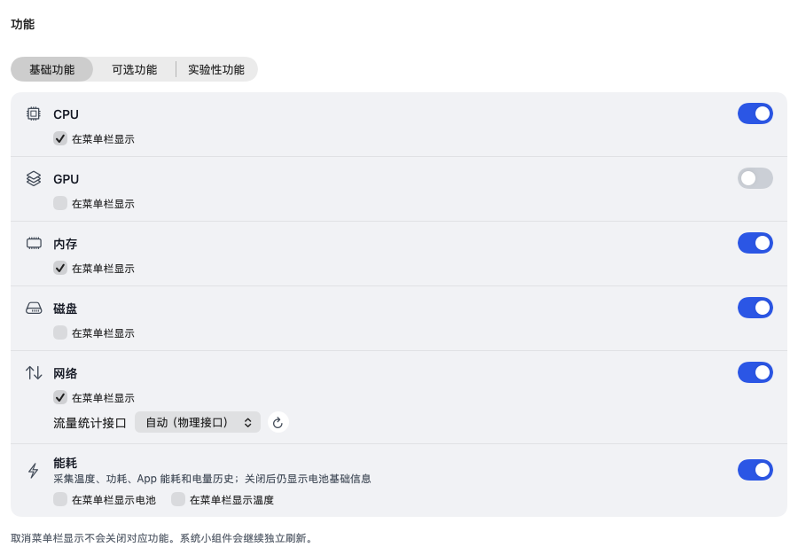
</p>
<p align="center">
  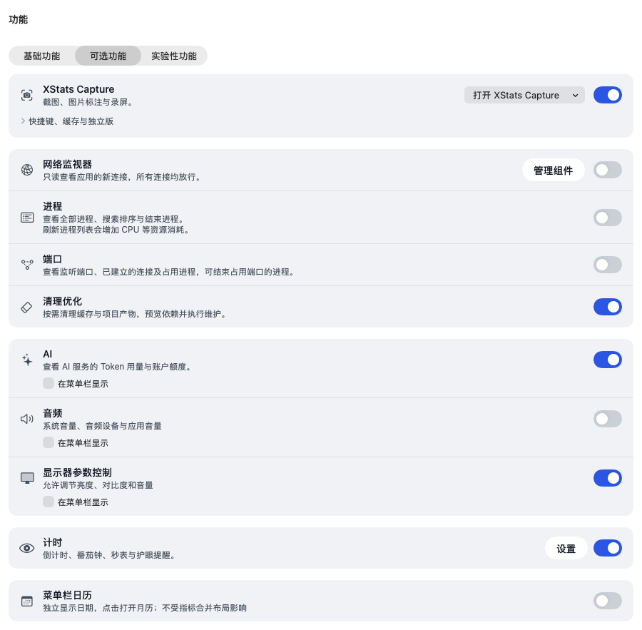
</p>
<p align="center">
  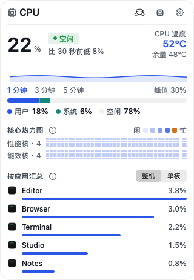
</p>
<p align="center">
  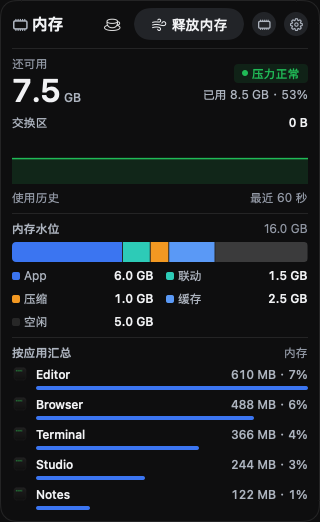
</p>
<p align="center">
  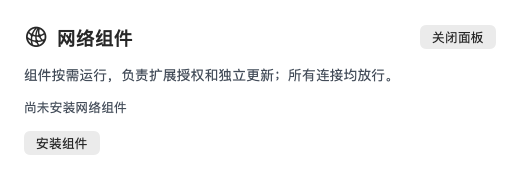
</p>
<p align="center">
  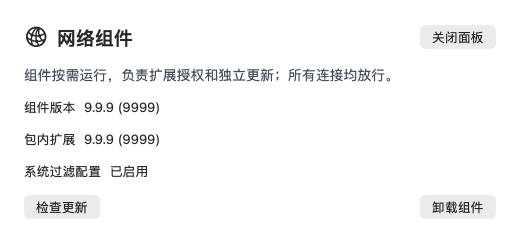
</p>
<p align="center">
  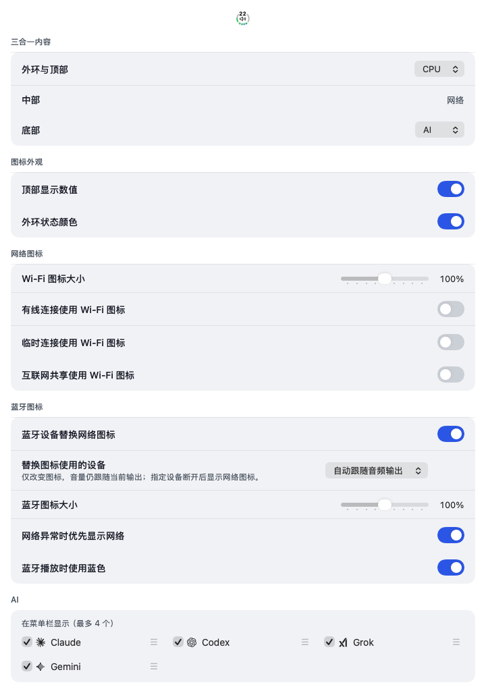
</p>
<p align="center">
  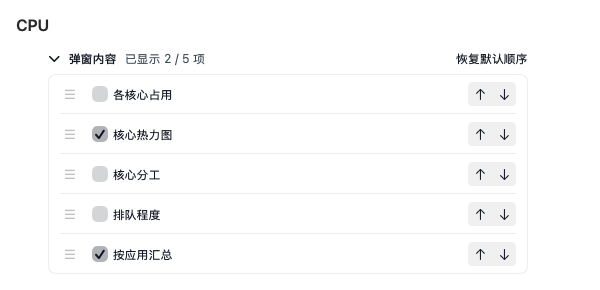
</p>
<p align="center">
  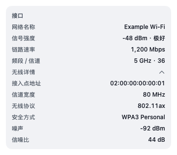
</p>
<p align="center">
  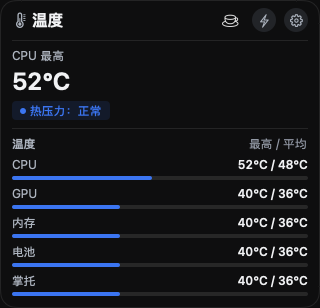
</p>
<p align="center">
  
</p>
<p align="center">
  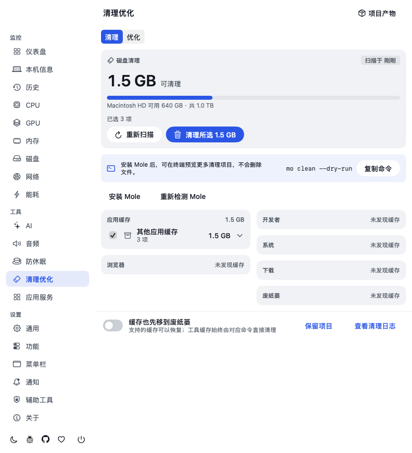
</p>
<p align="center">
  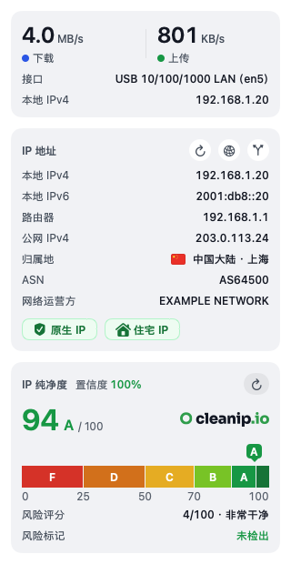
</p>
<p align="center">
  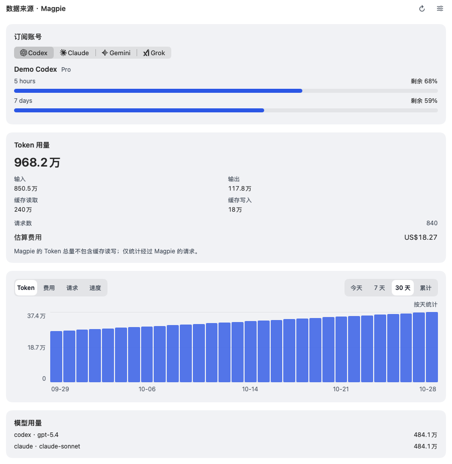
</p>
<p align="center">
  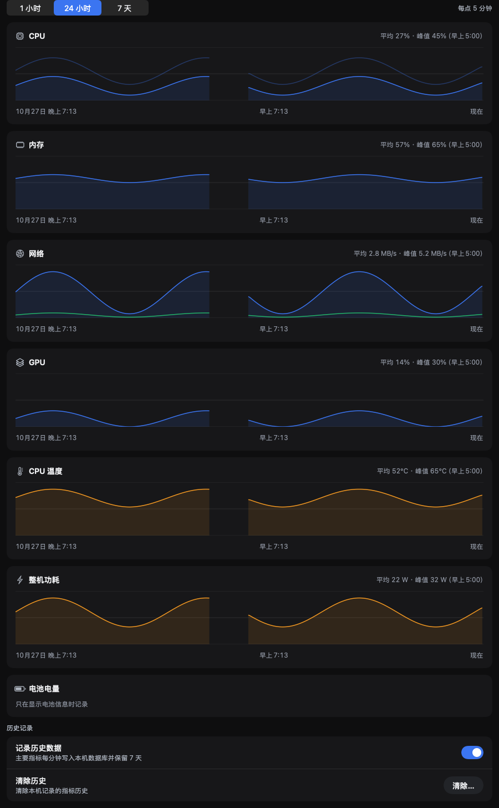
</p>
<p align="center">
  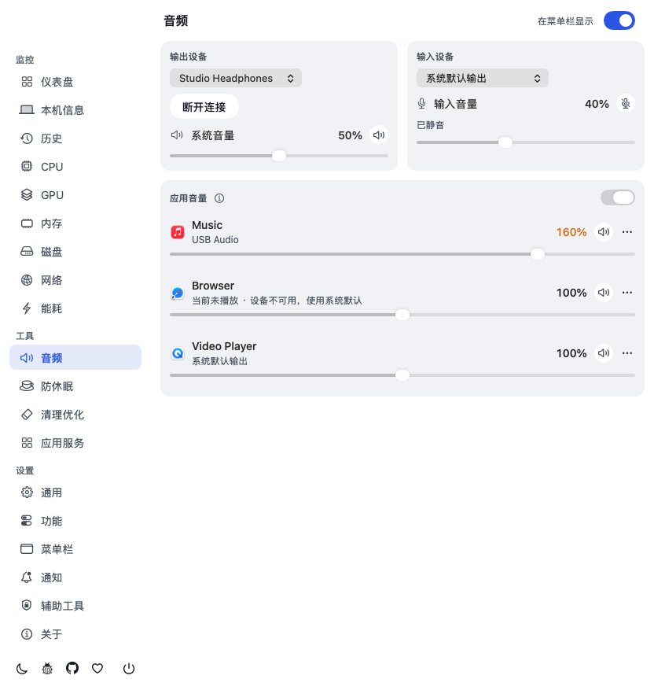
</p>
<p align="center">
  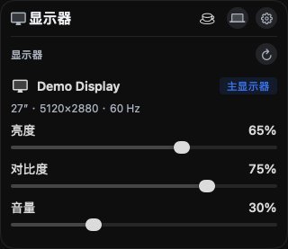
</p>
<p align="center">
  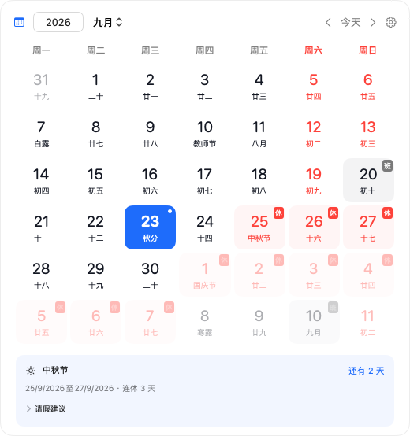
</p>
<p align="center">
  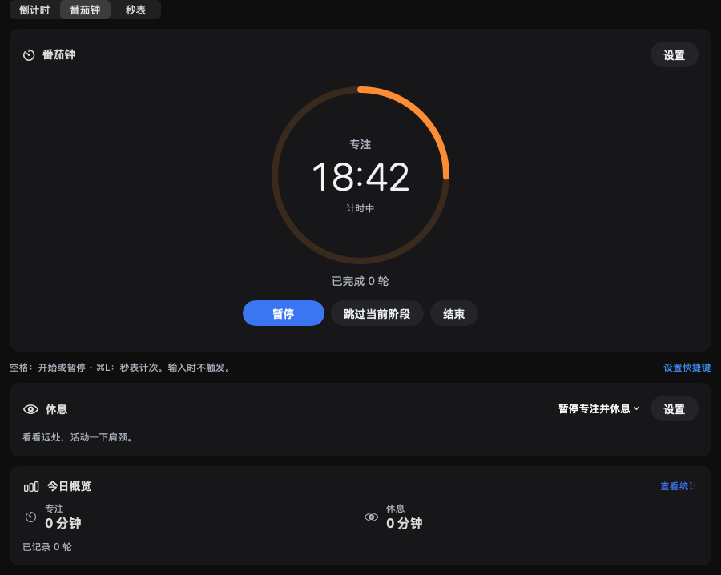
</p>

<p align="center">
  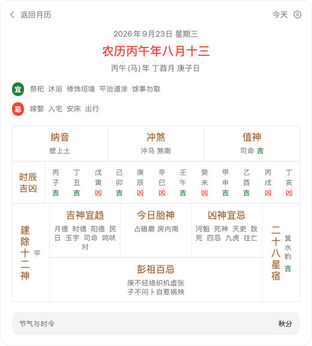
</p>

</details>

## Optional components and permissions

- **Network Monitor**: follow the separate component’s installation guide. An administrator account and macOS approval for the system extension and network filter are required. The component updates independently · [Installation and upgrades (Chinese)](docs/DEVELOPMENT.md#网络连接试验模块).
- **Helper**: privileged actions such as fan control and lid-closed keep-awake require installation and authorization of the helper.
- **Finder documents**: enable the Finder extension in System Settings · [Setup (Chinese)](docs/DEVELOPMENT.md#finder-新建文档).
- **XStats Capture**: see [Capture usage and permissions](docs/CAPTURE.md) for screenshot and recording access.

Native cleanup requires preview, selection and confirmation; items go to Trash or are deleted directly depending on type and settings. Mole can run after confirmation without a preview and permanently cleans using its own rules; native selections, exclusions and Trash settings do not apply. Uninstall requires confirmation and uses Trash.

## Data and privacy

Monitoring data, history and AI usage are processed locally.

- **Update checks**: send the version and a hashed installation ID to retrieve the update feed.
- **AI usage**: reads quotas and statistics through Magpie’s local API.
- **Online features**: component and geography database downloads, along with network diagnostics, connect to their respective services. Global-probe targets and results may be queried by others.
- **Menu bar folding**: this experimental macOS 27 feature requires access to one system configuration file to hide and restore selected apps.

See the [Privacy Policy](Packages/XStatsKit/Sources/XStatsUI/Resources/Legal/Privacy.en.md) and [Terms of Service](Packages/XStatsKit/Sources/XStatsUI/Resources/Legal/Terms.en.md) for details.

## Build and contribute

Issues and pull requests are welcome. See [DEVELOPMENT.md](docs/DEVELOPMENT.md) for setup and releases, and [ARCHITECTURE.md](docs/ARCHITECTURE.md) for module boundaries and implementation constraints.

## Releases

<!-- changelog:start -->
<!-- Generated from CHANGELOG.md by scripts/sync_changelog.py. Do not edit by hand. -->

Latest release **1.6.2** (2026-11-09) · [full changelog](CHANGELOG.md) (kept in Chinese)

<!-- changelog:end -->

## Credits and license

XStats builds on [OpenStats](https://github.com/gentpan/OpenStats). Thanks to its maintainers and the other open-source projects listed in [ThirdPartyNotices.md](ThirdPartyNotices.md), which includes their licenses and copyright notices. XStats is an independent third-party app, not affiliated with Apple or the other companies mentioned.

New XStats code and modifications are licensed under **AGPL-3.0-or-later**; see [LICENSE](LICENSE) and [LICENSING.md](LICENSING.md). Upstream OpenStats code retains its [MIT license](LICENSES/OpenStats-MIT.txt).
