<div align="center">


# XStats

**メインウインドウとメニューバーで使える、Mac のシステム監視と日常のツール。**

CPU、メモリ、ネットワーク、温度をひと目で確認し、詳細を開いて推移やアプリの使用状況を見られます。AI、カレンダー、ファン制御などのツールは必要なときに有効にできます。

[](https://github.com/ysicing/xstats/releases)
[](https://github.com/ysicing/xstats/actions/workflows/ci.yml)
[](https://github.com/ysicing/xstats/releases)
[](LICENSE)
[](https://twitter.com/YsiCing)

[最新版をダウンロード](https://github.com/ysicing/xstats/releases) · [機能](#機能) · [インストール](#インストール) · [データとプライバシー](#データとプライバシー) · [変更履歴（中国語）](CHANGELOG.md)

[简体中文](README.md) · [English](README.en.md) · **日本語** · [한국어](README.ko.md)

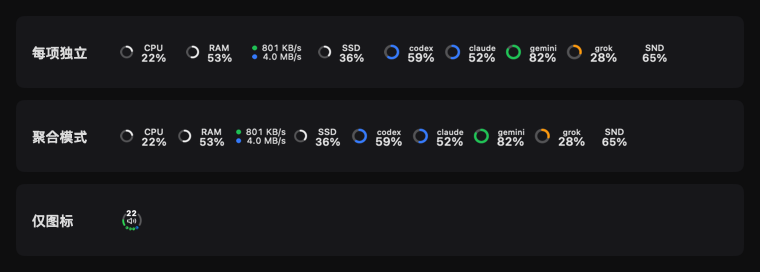

</div>

スクリーンショットのアカウント、アドレス、プロセス、指標、使用量、クリーンアップ結果はデモデータです。メインウインドウの機種とハードウェア機能は、この Mac から読み取った情報に基づき、対応状況は機種によって異なります。

## インストール

**Apple Silicon Mac と macOS 14 以降**が必要です。

[GitHub Releases](https://github.com/ysicing/xstats/releases) から DMG を入手し、XStats を「アプリケーション」にドラッグします。アプリがアップデートを確認し、インストールするかどうかはユーザーが選べます。

Homebrew でもインストールできます。

```bash
brew tap ysicing/tap
brew trust ysicing/tap
brew install --cask xstats
```

## 機能

XStats は Swift、AppKit、SwiftUI で開発した、無料のオープンソースのネイティブアプリです。アカウント登録は不要です。

### メニューバーと機能の有効化

指標を**個別表示**、**統合モード**、または自由に組み合わせた**3つの指標をまとめるアイコン**で表示できます。項目、順序、スタイルをカスタマイズし、概要から各指標の詳細を開けます。標準・手描きのアプリアイコンを選べ、Dock のリアルタイム表示にも対応します。

監視とツールは必要に応じて有効にし、メニューバーの項目は別に設定できます。項目を隠しても機能は停止しません。監視をオフにするとリアルタイム収集、関連通知、新しい履歴の記録を停止し、既存の履歴は保持します。

<p align="center">
  <picture>
    <source media="(prefers-color-scheme: dark)" srcset="Assets/readme/combined-overview-zh-Hans-dark.png">
    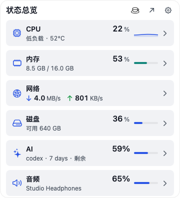
  </picture>
</p>

### システム監視

| モジュール | 内容 |
|---|---|
| **CPU** | 全体・コア別の使用率、負荷、周波数、温度 |
| **GPU** | グラフィックスの使用率、温度、消費電力 |
| **メモリ** | メモリプレッシャー、使用量の内訳、スワップ |
| **ディスク** | 容量、読み書きの速度、アプリ別 I/O、SMART 健全性 |
| **ネットワーク** | 上り・下り速度、インターフェイス、接続の概要 |
| **エネルギー** | 温度、消費電力、アプリのエネルギー、バッテリーと Bluetooth 機器の残量 |
| **ファン** | 回転数と対応機種での調節 |
| **ディスプレイ** | 解像度、リフレッシュレート、DDC/CI 対応の外部画面の調節 |
| **システム情報** | 機種、macOS、Apple Intelligence の状態、ローカルモデルの容量 |

周波数、温度、消費電力などの値は、機種と macOS が提供する場合に表示されます。

<p align="center">
  <picture>
    <source media="(prefers-color-scheme: dark)" srcset="Assets/readme/overview-dark.png">
    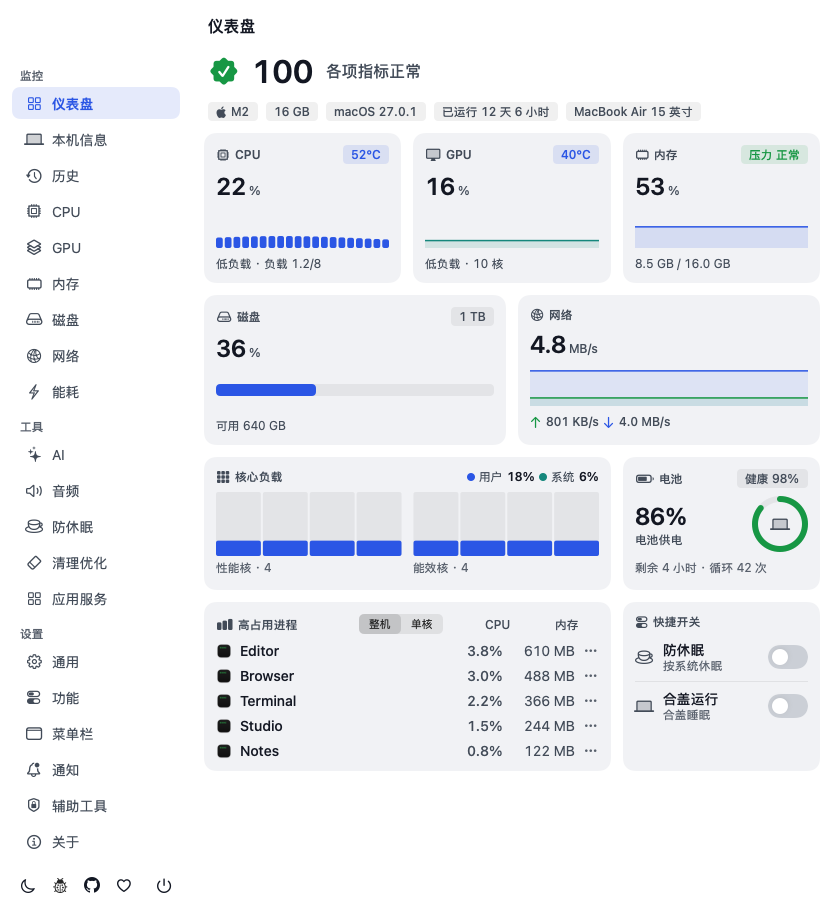
  </picture>
</p>

###  ネットワークモニター

**macOS 15 以降のオプション機能で、初期状態はオフです。別途ネットワークコンポーネントが必要です。** 観測した新しい接続、地図上の接続先、上り・下り通信量の推移をアプリ、プロセス、ドメイン、地域別に確認できます。

読み取り専用で、すべての通信を許可し、通信内容は読み取りません。ページが表示され、一時停止していない間だけ収集し、直近 15 分の履歴は本機に保存していつでも消去できます。地図データベースは初回にダウンロードし、その後はオフラインで検索します。位置は地域の代表点です。

<p align="center">
  <picture>
    <source media="(prefers-color-scheme: dark)" srcset="Assets/readme/connections-zh-Hans-dark.png">
    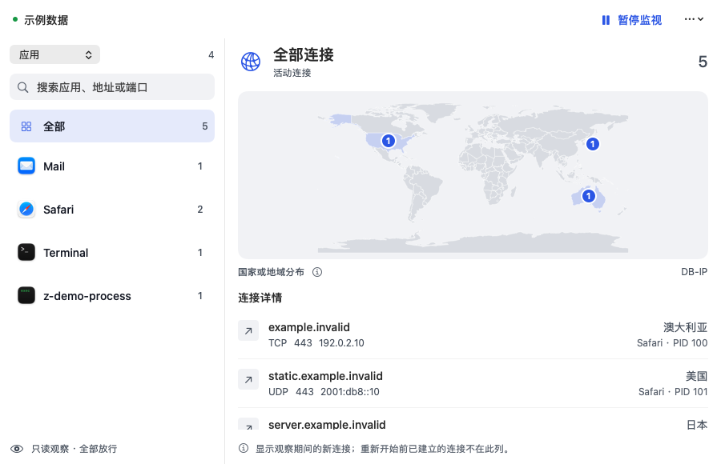
  </picture>
</p>

### AI

[Magpie](https://usemagpie.ai) をインストールして起動すると、メニューバーで AI サービスの使用量を確認できます。

- **使用量の推移**：トークン、リクエスト数、生成速度、米ドルの推定費用。推定額はサブスクリプションの請求額ではありません。
- **サブスクリプションアカウント**：プラン、利用枠の使用状況、リセット時刻。

AI 使用量は Magpie のローカル API のみに対応し、トークンは Magpie 経由のリクエストのみ集計します。

### ツール

コマンドバー、Launchpad、Finder での書類作成は、それぞれ個別に有効化する実験的機能です。

| ツール | 説明 |
|---|---|
| **コマンドバー** | アプリ・ファイル・操作の検索、プロセス・ポート・パッケージの照会 |
| **Launchpad** | **macOS 26 以降のみ**。グリッド・リスト・分類・フォルダ、自由なアプリ配置 |
| **Finder 書類作成** | 右クリックでテキスト・Office・iWork 書類を作成 |
|  **XStats Capture** | スクリーンショットの注釈・ローカルでのマスキング、音声付き画面収録。[単独版](https://github.com/ysicing/XStats/releases/tag/capture-v0.1.12)も利用可能 |
| **ファン制御** | 対応機種で自動 / 手動制御を切り替え |
| **スリープ防止** | 蓋を閉じた状態を含め、システムや画面のスリープを防止 |
| **アプリとサービス** | アプリ、Homebrew パッケージ、起動項目、サービスを管理 |
| **整理と最適化** | キャッシュとビルド成果物の確認、Mole にも対応 · [対象範囲](docs/CLEANUP.md) |
| **ネットワーク診断** | 速度、DNS、外部接続経路、公開 IP、接続性、WebRTC / DNS 漏洩の検査 |
| **カレンダー** | 旧暦、中国の祝日と振替出勤日、暦注、予定、リマインダー |
| **オーディオ** | 音量と機器の切り替え。macOS 14.4 以降はアプリ別の音量・出力調節 |
| **タイマー** | カウントダウン、ポモドーロ、ストップウォッチ、休憩・目の休憩通知、集中統計 |
| **プロセス管理** | 検索、並べ替え、アプリ別のグループ化、プロセスの終了 |

### 連携

- **デスクトップウィジェット**：システム概要、AI 利用枠とトークン、カレンダー、タイマー、世界時計、ネットワーク情報。
- **表示言語**：简体中文、繁體中文、English、日本語、한국어、Deutsch、Español、Français、العربية。
- **ディープリンク**：ランチャー、ショートカット、ターミナルからよく使う画面を表示 · [仕様（中国語）](docs/DEVELOPMENT.md#xstats-深链)。

<p align="center">
  <picture>
    <source media="(prefers-color-scheme: dark)" srcset="Assets/readme/widgets-zh-Hans-dark.png">
    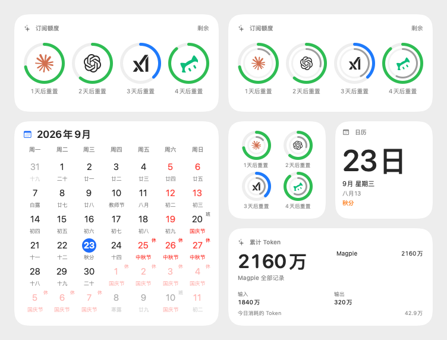
  </picture>
</p>

<details>
<summary>その他のスクリーンショット</summary>

<p align="center">
  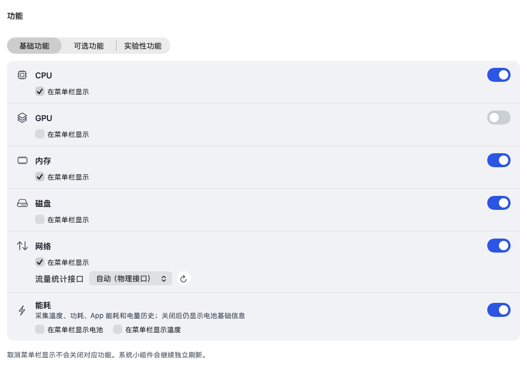
</p>
<p align="center">
  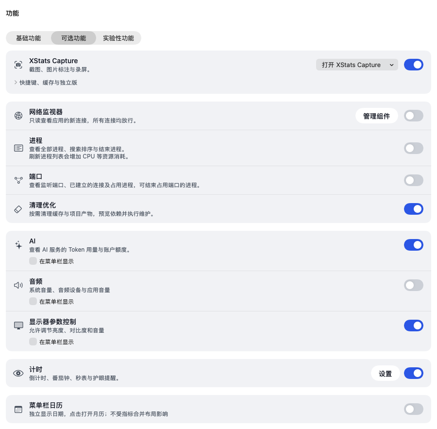
</p>
<p align="center">
  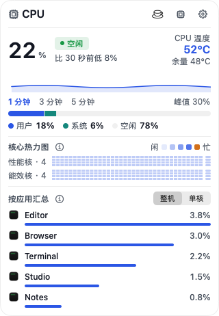
</p>
<p align="center">
  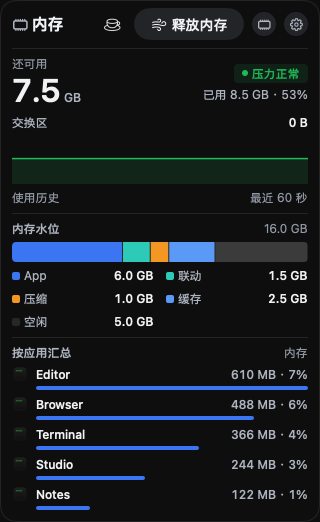
</p>
<p align="center">
  
</p>
<p align="center">
  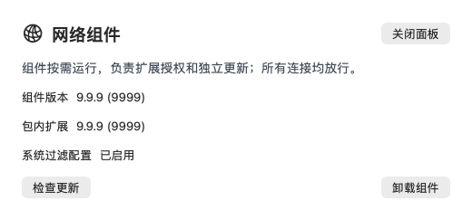
</p>
<p align="center">
  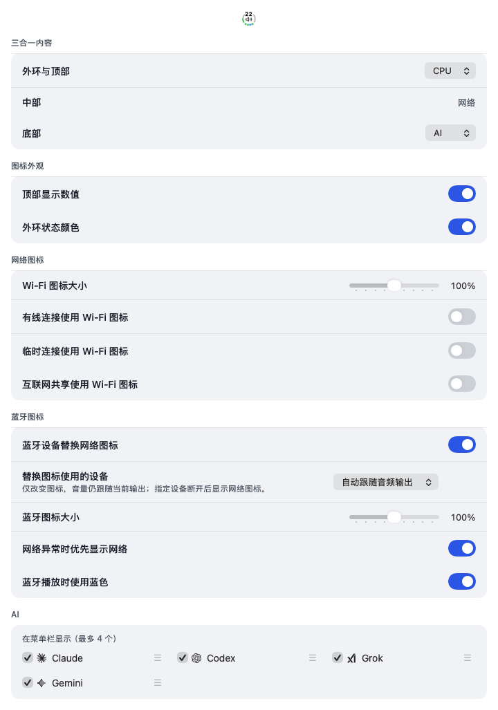
</p>
<p align="center">
  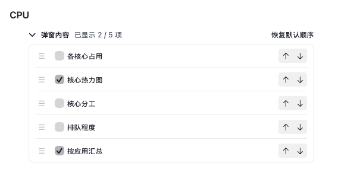
</p>
<p align="center">
  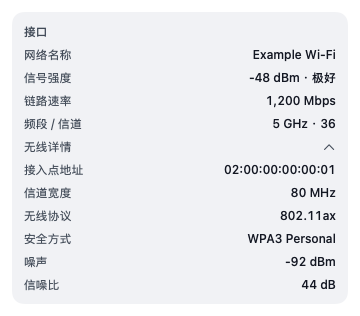
</p>
<p align="center">
  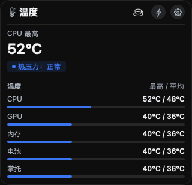
</p>
<p align="center">
  
</p>
<p align="center">
  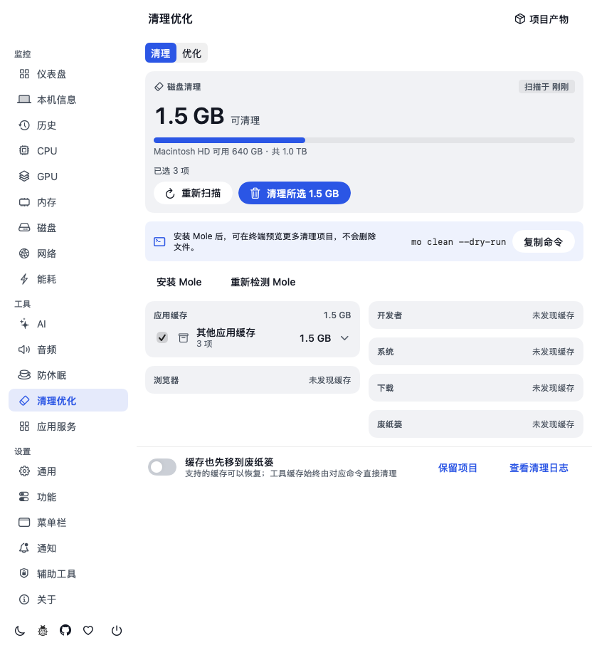
</p>
<p align="center">
  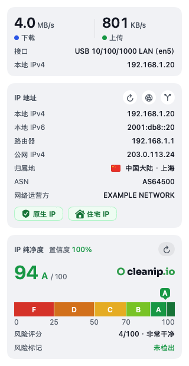
</p>
<p align="center">
  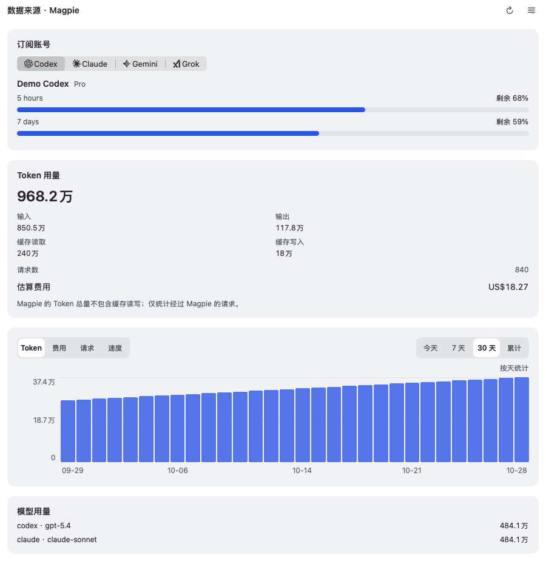
</p>
<p align="center">
  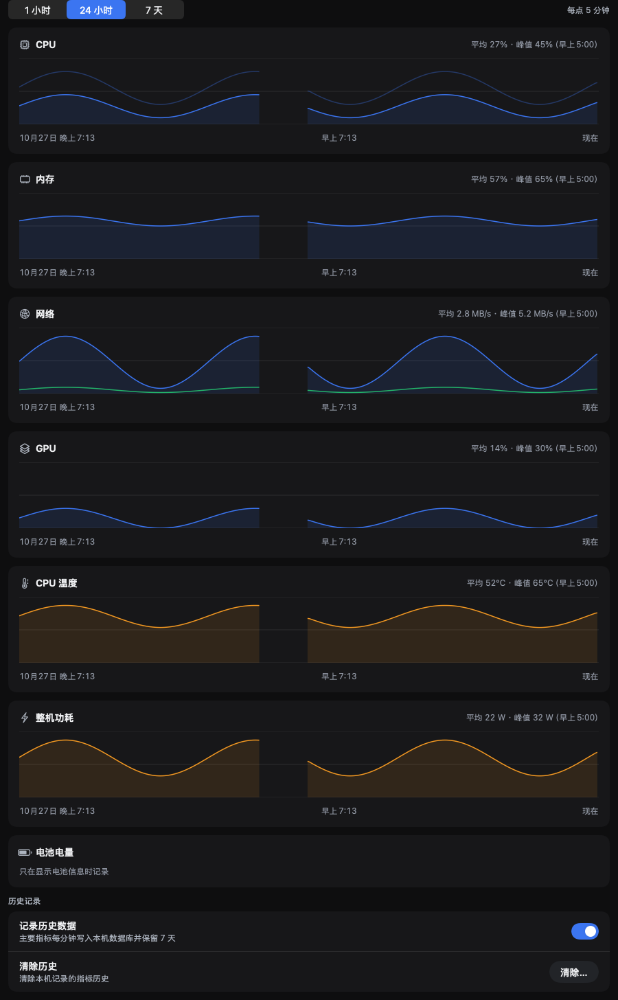
</p>
<p align="center">
  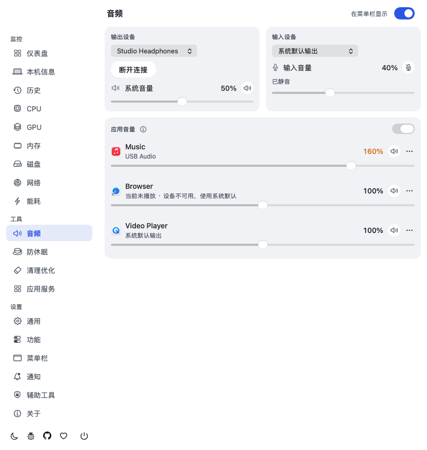
</p>
<p align="center">
  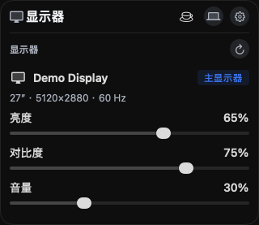
</p>
<p align="center">
  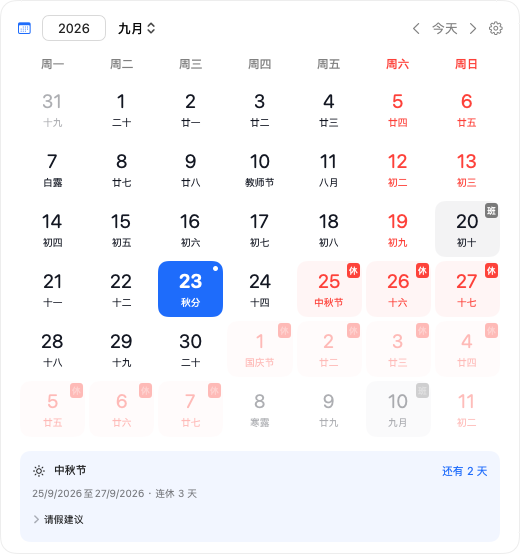
</p>
<p align="center">
  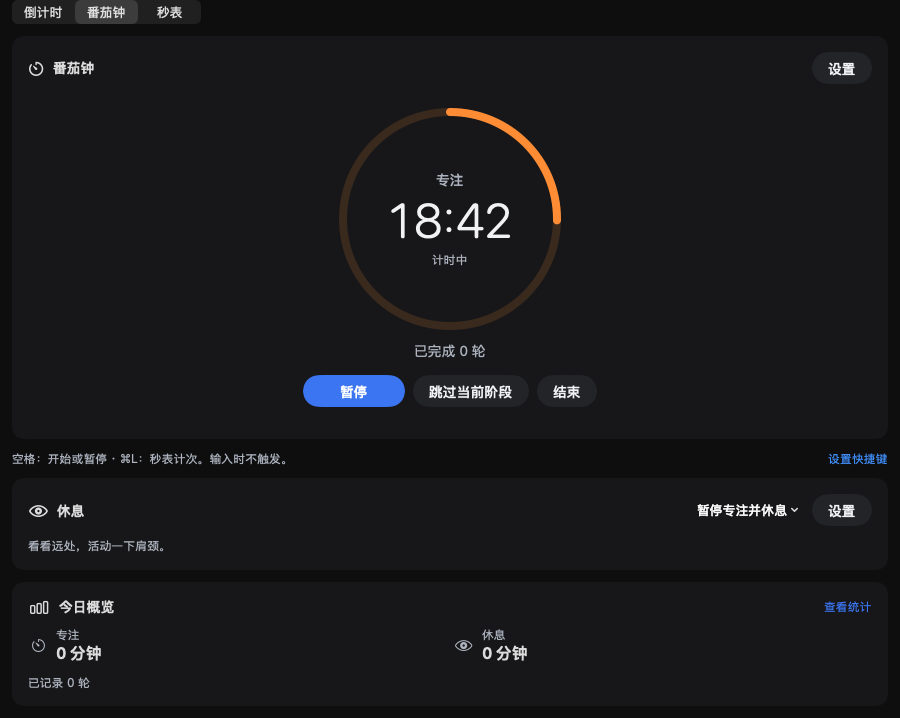
</p>

<p align="center">
  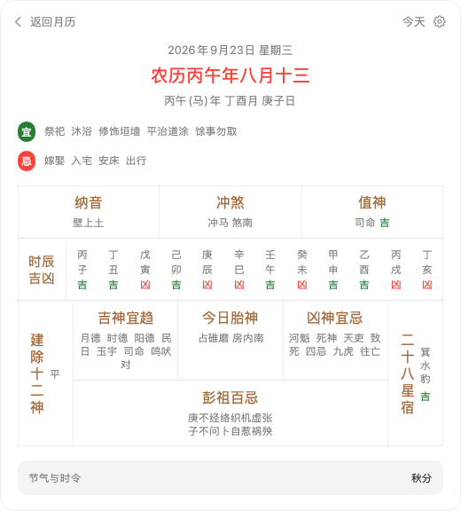
</p>

</details>

## オプションのコンポーネントと権限

- **ネットワークモニター**：案内に沿って別途コンポーネントをインストールします。管理者アカウントと、macOS でのシステム拡張・ネットワークフィルターの許可が必要です。コンポーネントは独立して更新します · [導入と更新（中国語）](docs/DEVELOPMENT.md#网络连接试验模块)。
- **補助ツール**：ファン制御や蓋を閉じた状態のスリープ防止などの特権操作には、補助ツールのインストールと許可が必要です。
- **Finder 書類作成**：システム設定で Finder 拡張を有効にしてください · [設定方法（中国語）](docs/DEVELOPMENT.md#finder-新建文档)。
- **XStats Capture**：スクリーンショットと画面収録の権限は[使い方と権限（中国語）](docs/CAPTURE.md)を参照してください。

標準のクリーンアップはプレビュー・選択・確認後に実行し、種類と設定に応じてゴミ箱へ移動するか直接削除します。Mole はプレビューなしでも確認後に実行でき、独自のルールで完全に削除します。標準の選択・除外・ゴミ箱設定は適用されません。アンインストールは確認後にゴミ箱へ移動します。

## データとプライバシー

監視データ、履歴、AI 使用量は本機で処理します。

- **アップデートの確認**：バージョンとインストール ID のハッシュを送り、更新情報を取得します。
- **AI 使用量**：Magpie のローカル API から利用枠と統計を取得します。
- **オンライン機能**：コンポーネントや地理データベースのダウンロード、ネットワーク診断は各サービスへ接続します。グローバルプローブの対象と結果は他の人が照会できる場合があります。
- **メニューバー折りたたみ**：macOS 27 の実験的機能です。選択したアプリの非表示と復元のため、システム設定ファイル 1 つへのアクセス許可が必要です。

詳細は[プライバシーポリシー（英語）](Packages/XStatsKit/Sources/XStatsUI/Resources/Legal/Privacy.en.md)と[利用規約（英語）](Packages/XStatsKit/Sources/XStatsUI/Resources/Legal/Terms.en.md)を参照してください。

## ビルドと貢献

Issue と Pull Request を歓迎します。環境構築とリリース手順は [DEVELOPMENT.md（中国語）](docs/DEVELOPMENT.md)、モジュールの境界と実装上の制約は [ARCHITECTURE.md（英語）](docs/ARCHITECTURE.md)を参照してください。

## 変更履歴

最新の変更は [CHANGELOG.md（中国語）](CHANGELOG.md)を参照してください。

## 謝辞とライセンス

XStats は [OpenStats](https://github.com/gentpan/OpenStats) を基に開発しています。元のプロジェクトと、[ThirdPartyNotices.md](ThirdPartyNotices.md) に記載した他のオープンソースプロジェクトに感謝します。XStats は Apple や本文に記載した企業とは独立した第三者アプリです。

XStats の新規コードと変更部分には **AGPL-3.0-or-later** を適用します。[LICENSE](LICENSE) と [LICENSING.md（中国語）](LICENSING.md)を参照してください。OpenStats の元のコードには [MIT ライセンス](LICENSES/OpenStats-MIT.txt)が引き続き適用されます。
