<div align="center">


# XStats

**앱 창과 메뉴 막대에서 사용하는 Mac 시스템 모니터링과 일상 도구.**

CPU, 메모리, 네트워크, 온도를 한눈에 보고, 세부 화면에서 추이와 앱 사용량을 확인하세요. AI, 달력, 팬 제어 등의 도구는 필요할 때 켤 수 있습니다.

[](https://github.com/ysicing/xstats/releases)
[](https://github.com/ysicing/xstats/actions/workflows/ci.yml)
[](https://github.com/ysicing/xstats/releases)
[](LICENSE)
[](https://twitter.com/YsiCing)

[최신 버전 다운로드](https://github.com/ysicing/xstats/releases) · [기능](#기능) · [설치](#설치) · [데이터와 개인정보](#데이터와-개인정보) · [변경 기록(중국어)](CHANGELOG.md)

[简体中文](README.md) · [English](README.en.md) · [日本語](README.ja.md) · **한국어**

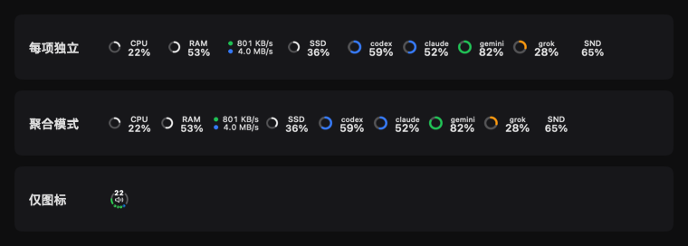

</div>

스크린샷의 계정, 주소, 프로세스, 지표, 사용량과 정리 결과는 데모 데이터입니다. 메인 윈도우의 Mac 모델과 하드웨어 기능은 이 Mac에서 읽은 정보이며, 지원 여부는 모델에 따라 다릅니다.

## 설치

**Apple Silicon Mac과 macOS 14 이상**이 필요합니다.

[GitHub Releases](https://github.com/ysicing/xstats/releases)에서 DMG를 받아 XStats를 ‘응용 프로그램’으로 드래그하세요. 앱이 업데이트를 확인하며, 설치 여부는 사용자가 선택합니다.

Homebrew로도 설치할 수 있습니다.

```bash
brew tap ysicing/tap
brew trust ysicing/tap
brew install --cask xstats
```

## 기능

XStats는 Swift, AppKit, SwiftUI로 만든 무료 오픈소스 네이티브 앱입니다. 계정 등록이 필요 없습니다.

### 메뉴 막대와 기능 활성화

지표를 **개별 표시**, **통합 모드** 또는 자유롭게 조합하는 **세 가지 지표 아이콘**으로 표시할 수 있습니다. 항목, 순서와 스타일을 바꾸고 개요에서 상세 정보를 열 수 있습니다. 표준 또는 손그림 앱 아이콘과 Dock의 실시간 상태 표시도 지원합니다.

모니터링과 도구는 필요에 따라 켜고 메뉴 막대 항목은 별도로 설정합니다. 항목을 숨겨도 기능은 꺼지지 않습니다. 모니터링을 끄면 실시간 수집, 관련 알림과 새 기록 저장을 중단하며 기존 기록은 유지합니다.

<p align="center">
  <picture>
    <source media="(prefers-color-scheme: dark)" srcset="Assets/readme/combined-overview-zh-Hans-dark.png">
    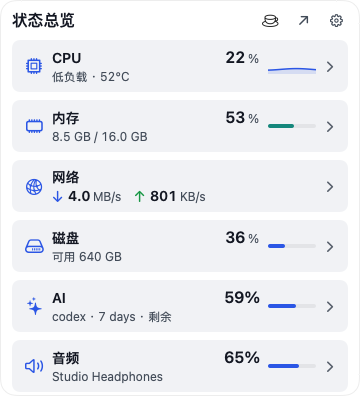
  </picture>
</p>

### 시스템 모니터링

| 모듈 | 내용 |
|---|---|
| **CPU** | 전체 및 코어별 사용률, 부하, 주파수, 온도 |
| **GPU** | 그래픽 사용률, 온도, 소비 전력 |
| **메모리** | 메모리 압력, 사용량 구성, 스왑 |
| **디스크** | 용량, 읽기/쓰기 속도, 앱별 I/O, SMART 상태 |
| **네트워크** | 업로드/다운로드 속도, 인터페이스, 연결 개요 |
| **에너지** | 온도, 소비 전력, 앱 에너지, 배터리와 Bluetooth 기기 잔량 |
| **팬** | 회전수와 지원 기종의 속도 조절 |
| **디스플레이** | 해상도, 주사율, DDC/CI 외부 화면 조절 |
| **시스템 정보** | 기종, macOS, Apple Intelligence 상태, 로컬 모델 용량 |

주파수, 온도, 소비 전력 등의 수치는 기종과 macOS가 제공하는 경우에 표시됩니다.

<p align="center">
  <picture>
    <source media="(prefers-color-scheme: dark)" srcset="Assets/readme/overview-dark.png">
    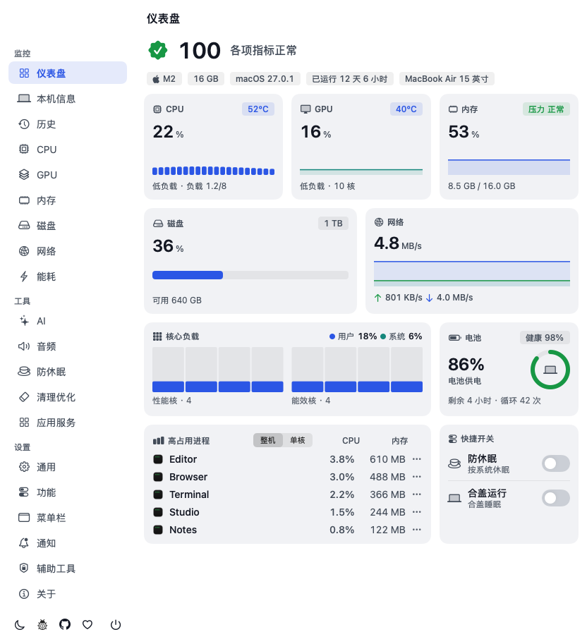
  </picture>
</p>

###  네트워크 모니터

**macOS 15 이상에서 선택적으로 사용하며 기본적으로 꺼져 있고, 별도 네트워크 구성요소가 필요합니다.** 관찰 중 새로 발생한 연결, 지도상의 목적지와 업로드·다운로드 추이를 앱, 프로세스, 도메인 또는 지역별로 확인합니다.

읽기 전용으로 모든 통신을 허용하며 통신 내용은 읽지 않습니다. 페이지가 보이고 일시 정지하지 않은 동안만 수집하고 최근 15분의 이력은 이 Mac에 저장되어 언제든 지울 수 있습니다. 지도 데이터베이스는 처음 사용할 때 내려받고 이후 오프라인으로 조회하며, 위치는 지역의 대표 지점입니다.

<p align="center">
  <picture>
    <source media="(prefers-color-scheme: dark)" srcset="Assets/readme/connections-zh-Hans-dark.png">
    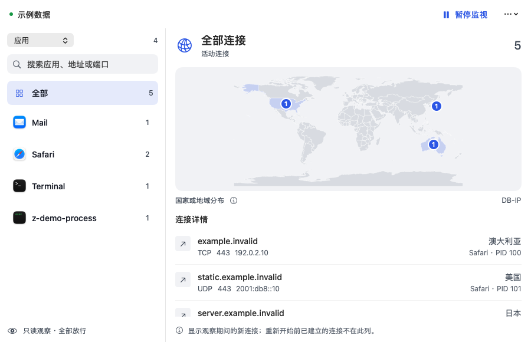
  </picture>
</p>

### AI

[Magpie](https://usemagpie.ai)를 설치하고 실행하면 메뉴 막대에서 AI 서비스 사용량을 확인할 수 있습니다.

- **사용량 추이**: 토큰, 요청 수, 생성 속도와 미국 달러 추정 비용. 추정액은 구독 청구액이 아닙니다.
- **구독 계정**: 요금제, 한도 사용량과 초기화 시각.

AI 사용량은 Magpie의 로컬 API만 지원하며 토큰은 Magpie를 거친 요청만 집계합니다.

### 도구

명령 모음, Launchpad와 Finder의 새 문서 만들기는 각각 독립적으로 켜는 실험적 기능입니다.

| 도구 | 설명 |
|---|---|
| **명령 모음** | 앱·파일·작업 검색, 프로세스·포트·패키지 조회 |
| **Launchpad** | **macOS 26 이상 전용**. 격자·목록·분류·폴더와 앱 배치 설정 |
| **Finder 새 문서** | 우클릭 메뉴에서 텍스트·Office·iWork 문서 만들기 |
|  **XStats Capture** | 스크린샷 주석·로컬 정보 가리기, 소리 포함 화면 녹화. [독립 앱](https://github.com/ysicing/XStats/releases/tag/capture-v0.1.12)도 제공 |
| **팬 제어** | 지원되는 기기에서 자동 / 수동 제어 전환 |
| **잠자기 방지** | 덮개를 닫은 상태를 포함해 시스템이나 화면을 깨어 있게 유지 |
| **앱 및 서비스** | 앱, Homebrew 패키지, 시작 항목과 서비스 관리 |
| **정리 및 최적화** | 캐시와 빌드 결과물 검토, Mole도 지원 · [정리 범위](docs/CLEANUP.md) |
| **네트워크 진단** | 속도, DNS, 외부 연결 경로, 공인 IP, 연결 및 WebRTC / DNS 유출 검사 |
| **달력** | 음력, 중국 공휴일과 대체 근무일, 역서, 일정과 미리 알림 |
| **오디오** | 음량·기기 전환. macOS 14.4 이상에서 앱별 음량·출력 조절 |
| **타이머** | 카운트다운, 뽀모도로, 스톱워치, 세계 시계, 휴식·눈 휴식 알림, 로컬 집중 통계 |
| **프로세스 관리** | 검색, 정렬, 앱별 그룹화, 프로세스 종료 |

### 연동

- **데스크톱 위젯**: 시스템 개요, AI 한도와 토큰, 달력, 타이머, 시간대와 네트워크 정보.
- **언어**: 简体中文, 繁體中文, English, 日本語, 한국어, Deutsch, Español, Français, العربية.
- **딥 링크**: 런처, 단축어 또는 터미널에서 자주 쓰는 화면 열기 · [프로토콜(중국어)](docs/DEVELOPMENT.md#xstats-深链).

<p align="center">
  <picture>
    <source media="(prefers-color-scheme: dark)" srcset="Assets/readme/widgets-zh-Hans-dark.png">
    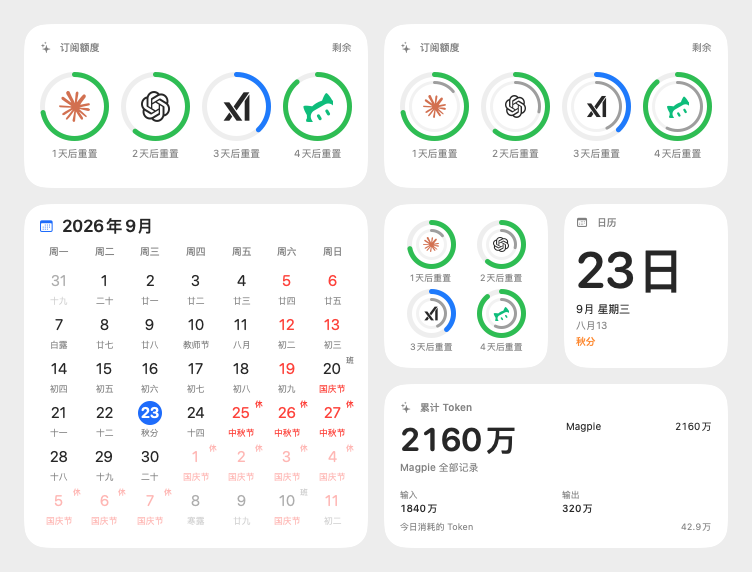
  </picture>
</p>

<details>
<summary>더 많은 스크린샷</summary>

<p align="center">
  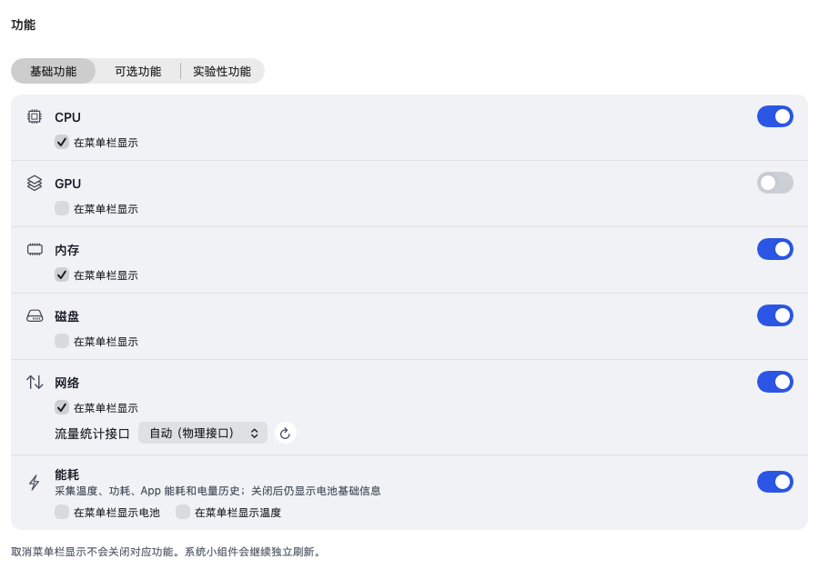
</p>
<p align="center">
  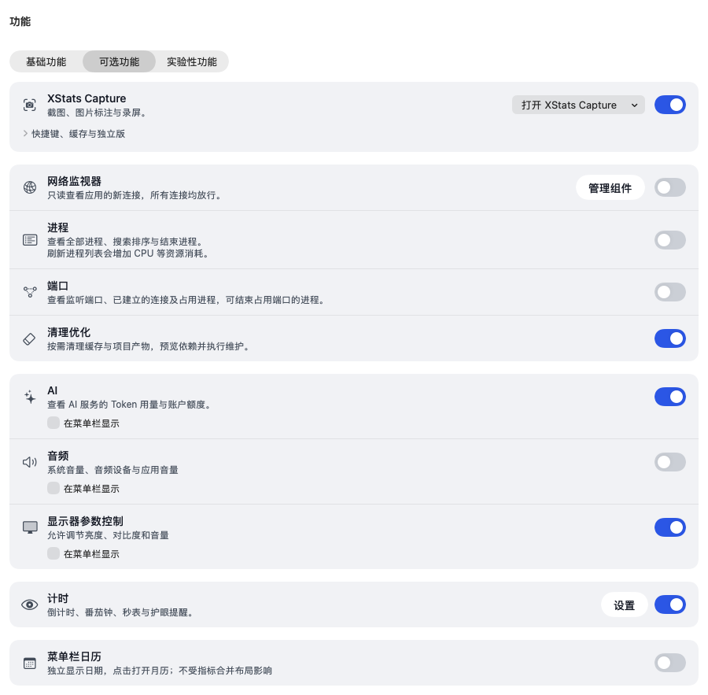
</p>
<p align="center">
  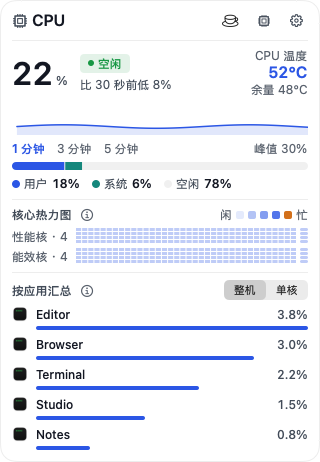
</p>
<p align="center">
  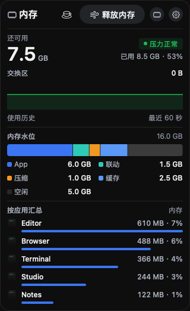
</p>
<p align="center">
  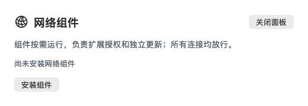
</p>
<p align="center">
  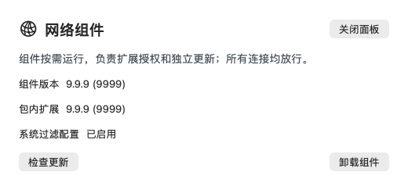
</p>
<p align="center">
  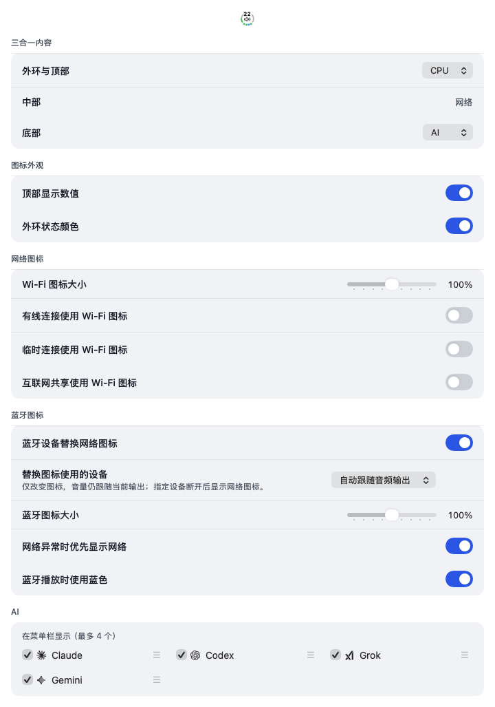
</p>
<p align="center">
  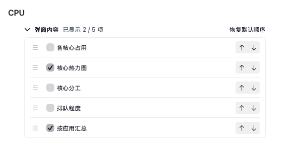
</p>
<p align="center">
  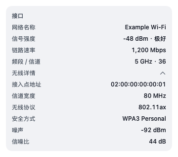
</p>
<p align="center">
  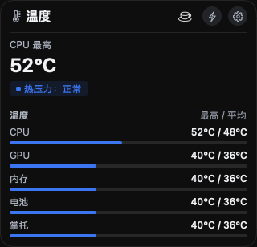
</p>
<p align="center">
  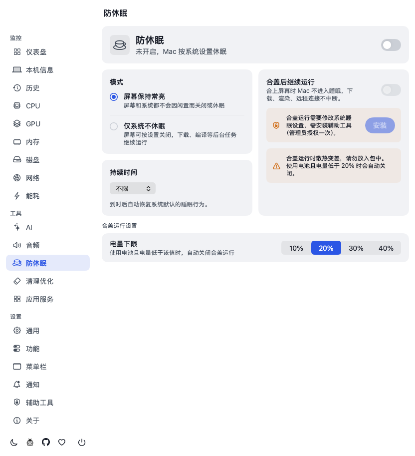
</p>
<p align="center">
  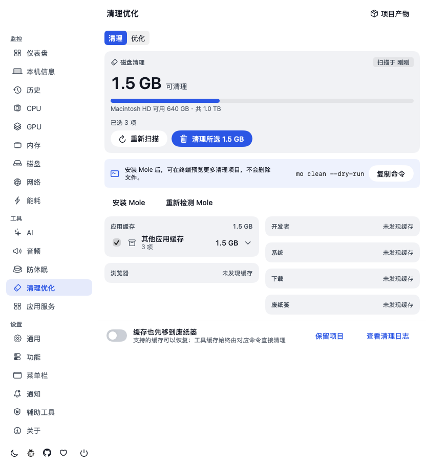
</p>
<p align="center">
  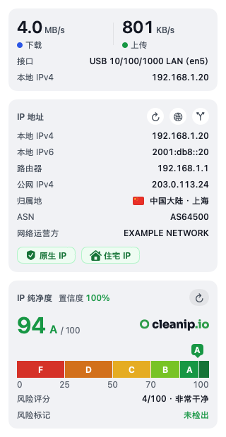
</p>
<p align="center">
  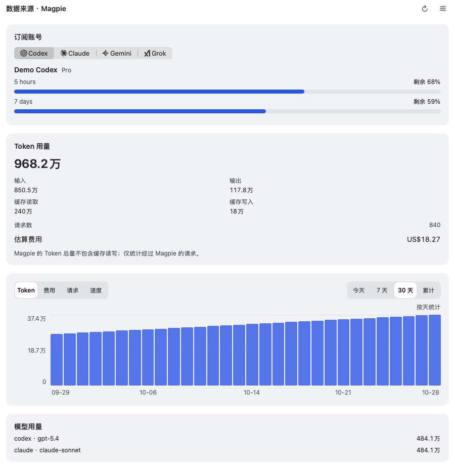
</p>
<p align="center">
  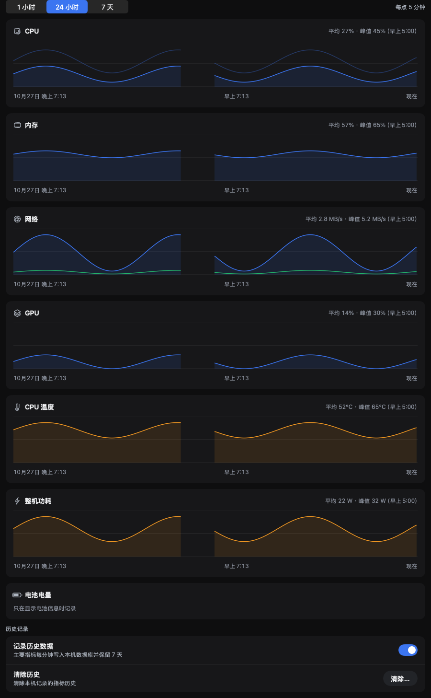
</p>
<p align="center">
  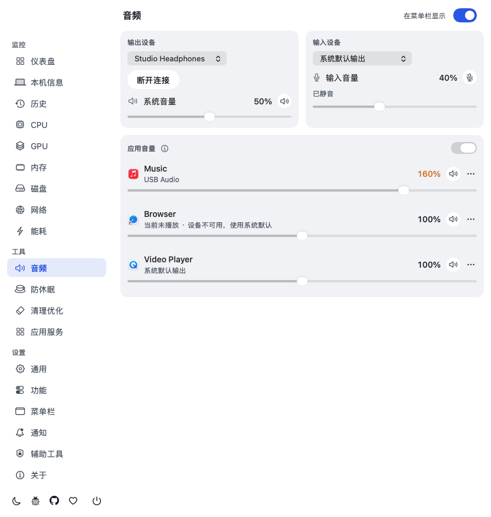
</p>
<p align="center">
  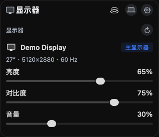
</p>
<p align="center">
  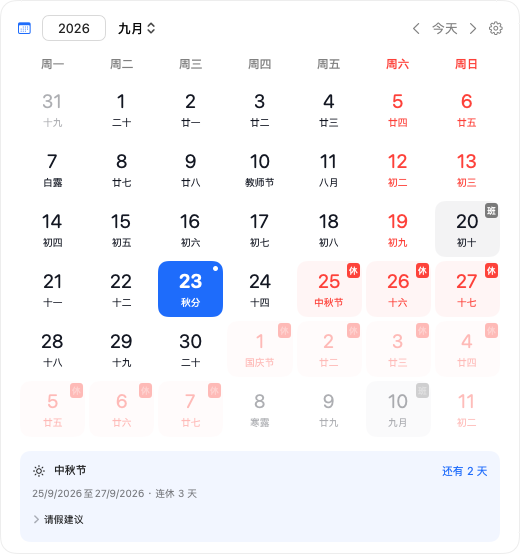
</p>
<p align="center">
  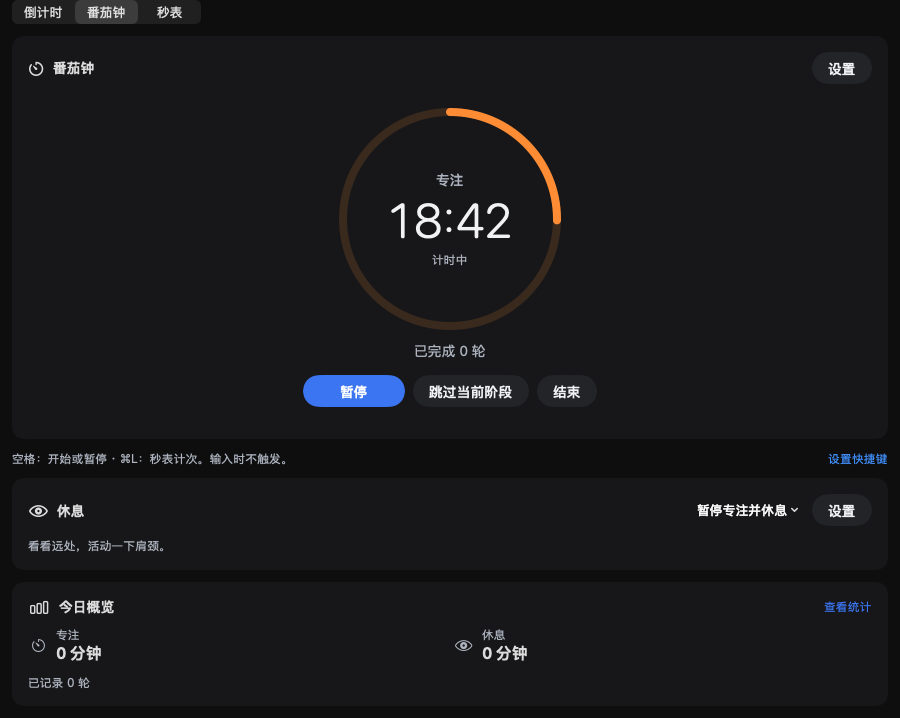
</p>

<p align="center">
  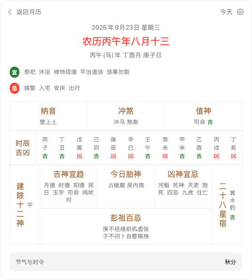
</p>

</details>

## 선택 구성요소와 권한

- **네트워크 모니터**: 안내에 따라 별도 구성요소를 설치합니다. 관리자 계정과 macOS의 시스템 확장·네트워크 필터 승인이 필요하며, 구성요소는 독립적으로 업데이트됩니다 · [설치와 업그레이드(중국어)](docs/DEVELOPMENT.md#网络连接试验模块).
- **보조 도구**: 팬 제어와 덮개를 닫은 상태의 잠자기 방지 등 권한이 필요한 작업에는 보조 도구 설치와 승인이 필요합니다.
- **Finder 새 문서**: 시스템 설정에서 Finder 확장을 켜야 합니다 · [설정 안내(중국어)](docs/DEVELOPMENT.md#finder-新建文档).
- **XStats Capture**: 스크린샷과 화면 녹화의 권한 범위는 [사용법과 권한(중국어)](docs/CAPTURE.md)을 참고하세요.

기본 정리는 미리 보기·선택·확인 후 실행하며, 유형과 설정에 따라 휴지통으로 옮기거나 직접 삭제합니다. Mole은 미리 보기 없이도 확인 후 실행할 수 있고 자체 규칙으로 영구 정리합니다. 기본 엔진의 선택·제외 항목과 휴지통 설정은 적용되지 않습니다. 앱 제거는 확인 후 휴지통으로 옮깁니다.

## 데이터와 개인정보

모니터링 데이터, 기록, AI 사용량은 기기에서 처리합니다.

- **업데이트 확인**: 버전과 설치 ID의 해시를 보내 업데이트 정보를 가져옵니다.
- **AI 사용량**: Magpie의 로컬 API에서 한도와 통계를 읽습니다.
- **온라인 기능**: 구성요소와 지리 데이터베이스 다운로드, 네트워크 진단은 해당 서비스에 연결합니다. 글로벌 프로브의 대상과 결과는 다른 사람이 조회할 수 있습니다.
- **메뉴 막대 접기**: macOS 27의 실험적 기능으로, 선택한 앱을 숨기고 복원하기 위해 시스템 설정 파일 하나에 대한 접근 권한이 필요합니다.

자세한 내용은 [개인정보 처리방침(영어)](Packages/XStatsKit/Sources/XStatsUI/Resources/Legal/Privacy.en.md)과 [서비스 약관(영어)](Packages/XStatsKit/Sources/XStatsUI/Resources/Legal/Terms.en.md)을 확인하세요.

## 빌드와 기여

Issue와 Pull Request를 환영합니다. 환경 설정과 릴리스 과정은 [DEVELOPMENT.md(중국어)](docs/DEVELOPMENT.md), 모듈 경계와 구현 제약은 [ARCHITECTURE.md(영어)](docs/ARCHITECTURE.md)을 참고하세요.

## 변경 기록

최신 변경 사항은 [CHANGELOG.md(중국어)](CHANGELOG.md)를 확인하세요.

## 감사와 라이선스

XStats는 [OpenStats](https://github.com/gentpan/OpenStats)를 기반으로 개발되었습니다. 원 프로젝트와 [ThirdPartyNotices.md](ThirdPartyNotices.md)에 명시한 다른 오픈 소스 프로젝트에 감사드립니다. XStats는 Apple 및 본문에 언급한 회사와 관계없는 독립적인 서드파티 앱입니다.

XStats의 새 코드와 수정 부분에는 **AGPL-3.0-or-later**가 적용됩니다. [LICENSE](LICENSE)와 [LICENSING.md(중국어)](LICENSING.md)를 확인하세요. 기존 OpenStats 코드는 [MIT 라이선스](LICENSES/OpenStats-MIT.txt)를 유지합니다.
