<div align="center">


# XStats

**Mac 系统监控与常用工具，兼具主窗口和菜单栏体验。**

CPU、内存、网络与温度一眼可见，展开即可查看趋势与应用占用；AI、日历、风扇控制等工具按需启用。

[](https://github.com/ysicing/xstats/releases)
[](https://github.com/ysicing/xstats/actions/workflows/ci.yml)
[](https://github.com/ysicing/xstats/releases)
[](LICENSE)
[](https://twitter.com/YsiCing)

[下载最新版](https://github.com/ysicing/xstats/releases) · [功能](#功能) · [安装](#安装) · [数据与隐私](#数据与隐私) · [更新日志](CHANGELOG.md)

**简体中文** · [English](README.en.md) · [日本語](README.ja.md) · [한국어](README.ko.md)

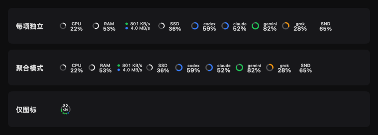

</div>

截图中的账号、地址、进程、指标、用量与清理结果均为演示数据；主窗口的机型与硬件能力来自本机只读信息，支持情况因机型而异。

## 安装

需要 **Apple 芯片 Mac 与 macOS 14 或更新版本**。

从 [GitHub Releases](https://github.com/ysicing/xstats/releases) 下载 DMG，将 XStats 拖入“应用程序”。应用内置更新检查，是否安装新版本由你决定。

也可通过 Homebrew 安装：

```bash
brew tap ysicing/tap
brew trust ysicing/tap
brew install --cask xstats
```

## 功能

XStats 使用 Swift、AppKit 与 SwiftUI 原生开发，免费开源，无需注册账号。

### 菜单栏与按需启用

指标可**独立显示**、使用**聚合模式**，或合成一个自由搭配的**三合一图标**。显示项目、顺序与样式均可自定义，聚合总览可直接打开指标详情。应用图标可选择标准 Logo 或手绘形象，支持程序坞实时状态。

监控与工具可按需启用，菜单栏入口单独配置。隐藏入口不会关闭功能；关闭监控会停止实时采集、相关提醒与新增历史，保留已有记录。

<p align="center">
  <picture>
    <source media="(prefers-color-scheme: dark)" srcset="Assets/readme/combined-overview-zh-Hans-dark.png">
    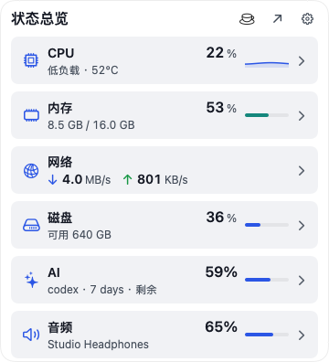
  </picture>
</p>

### 系统监控

| 模块 | 内容 |
|---|---|
| **CPU** | 总体与逐核占用、负载、频率和温度 |
| **GPU** | 图形负载、温度与功耗 |
| **内存** | 内存压力、使用构成与交换空间 |
| **磁盘** | 容量、读写速率、应用读写排行与 SMART 健康信息 |
| **网络** | 上下行速率、网络接口与连接概况 |
| **能耗** | 温度、功耗、App 能耗、电池与蓝牙设备电量 |
| **风扇** | 转速与支持机型的调速 |
| **显示器** | 分辨率与刷新率，支持 DDC/CI 的外接屏参数调节 |
| **系统信息** | 机型、系统、Apple 智能状态与本机模型占用 |

频率、温度、功耗等读数取决于机型和系统是否提供。

<p align="center">
  <picture>
    <source media="(prefers-color-scheme: dark)" srcset="Assets/readme/overview-dark.png">
    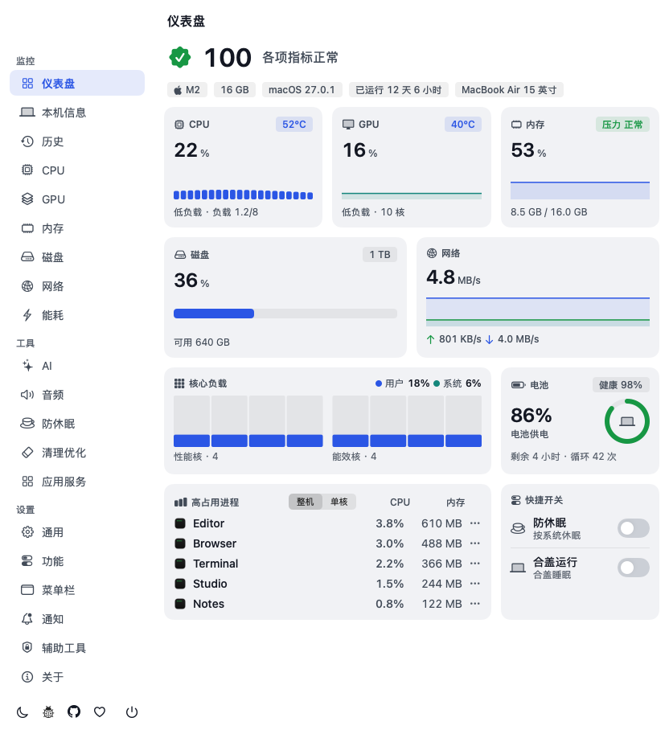
  </picture>
</p>

###  网络监视器

**macOS 15+ 的可选功能，默认关闭，需要独立网络组件。** 按应用、进程、域名或地区查看观察期间的新连接、地图去向与上下行走势。

只读观察，全部连接放行，不读取通信内容；仅在页面可见且未暂停时采集，最近 15 分钟的历史保留在本机，可随时清空。地图数据库首次按需下载，之后离线查询，位置为地区代表点。

<p align="center">
  <picture>
    <source media="(prefers-color-scheme: dark)" srcset="Assets/readme/connections-zh-Hans-dark.png">
    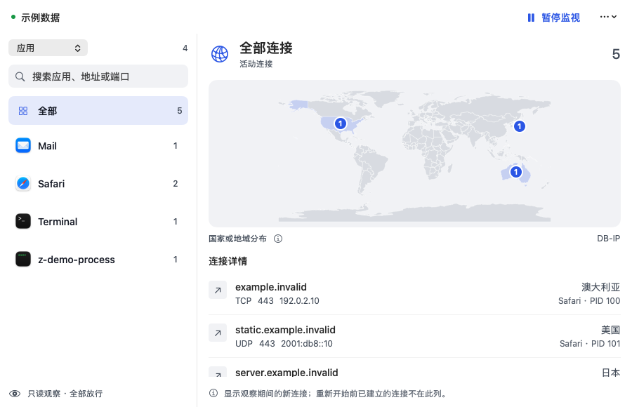
  </picture>
</p>

### AI

安装并运行 [Magpie](https://usemagpie.ai) 后，可在菜单栏查看 AI 服务用量：

- **用量走势**：Token、请求数、生成速度与美元费用估算，费用不代表订阅账单。
- **订阅账号**：套餐、额度使用情况与重置时间。

AI 用量仅支持 Magpie 本地接口；Token 仅统计经过 Magpie 的请求。

### 工具

命令栏、启动台与 Finder 新建文档均为独立启用的实验性功能。

| 工具 | 说明 |
|---|---|
| **命令栏** | 搜索应用、文件与操作，查询进程、端口和软件包 |
| **启动台** | 仅限 **macOS 26+**；网格、列表、分类与文件夹，自定义应用布局 |
| **Finder 新建文档** | 通过右键菜单新建文本、Office 与 iWork 文档 |
|  **XStats Capture** | 截图标注、本地打码与带声音的录屏；也可[单独下载](https://github.com/ysicing/XStats/releases/tag/capture-v0.1.12) |
| **风扇控制** | 在支持的设备上切换自动或手动控制 |
| **防休眠** | 保持系统或屏幕唤醒，支持合盖运行 |
| **应用服务** | 管理应用、Homebrew 软件包、启动项与服务 |
| **清理优化** | 审阅缓存与项目产物，支持 Mole 引擎 · [清理范围](docs/CLEANUP.md) |
| **网络诊断** | 测速、DNS、出口与公网 IP、连通性及 WebRTC / DNS 泄漏检测 |
| **日历** | 农历、节假日与调休、黄历、系统日程和提醒事项 |
| **音频** | 音量与设备切换；macOS 14.4+ 支持应用音量与输出调节 |
| **计时** | 倒计时、番茄钟、秒表、休息与护眼提醒、本机专注统计 |
| **进程管理** | 搜索、排序、按应用分组与结束进程 |

### 集成

- **桌面小组件**：系统概览、AI 额度与 Token、日历、计时、时区与网络信息。
- **多语言**：简体中文、繁體中文、English、日本語、한국어、Deutsch、Español、Français、العربية。
- **深链**：从启动器、快捷指令或终端打开常用入口 · [深链协议](docs/DEVELOPMENT.md#xstats-深链)。

<p align="center">
  <picture>
    <source media="(prefers-color-scheme: dark)" srcset="Assets/readme/widgets-zh-Hans-dark.png">
    
  </picture>
</p>

<details>
<summary>更多截图</summary>

<p align="center">
  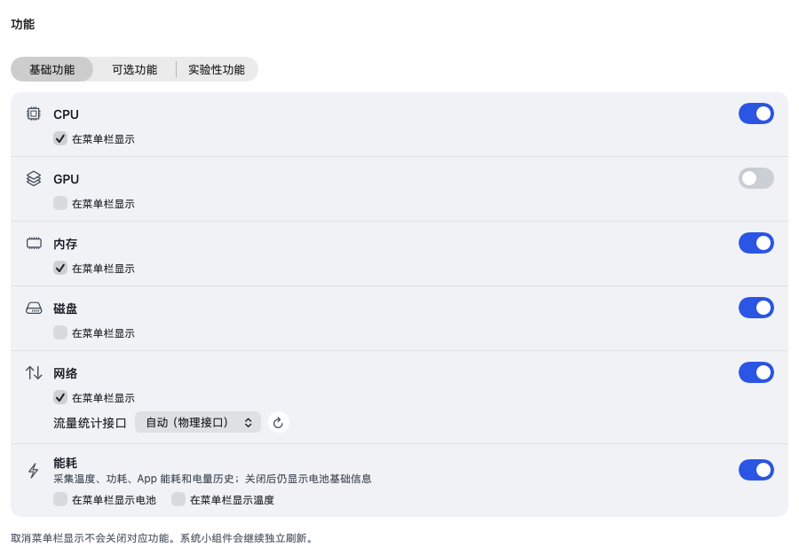
</p>
<p align="center">
  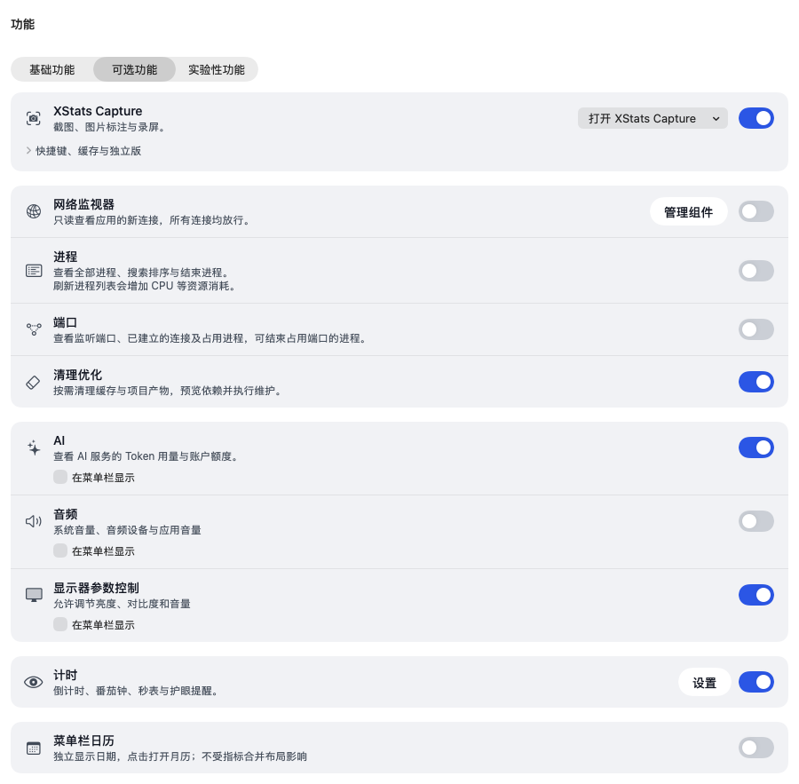
</p>
<p align="center">
  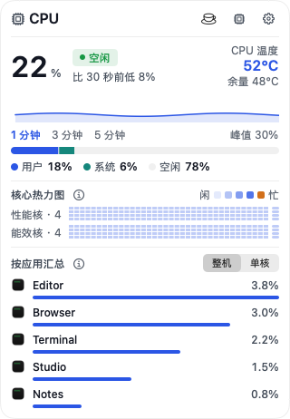
</p>
<p align="center">
  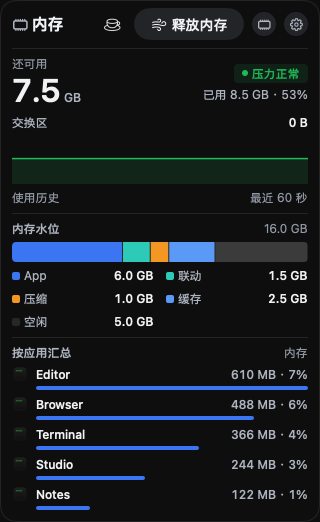
</p>
<p align="center">
  
</p>
<p align="center">
  
</p>
<p align="center">
  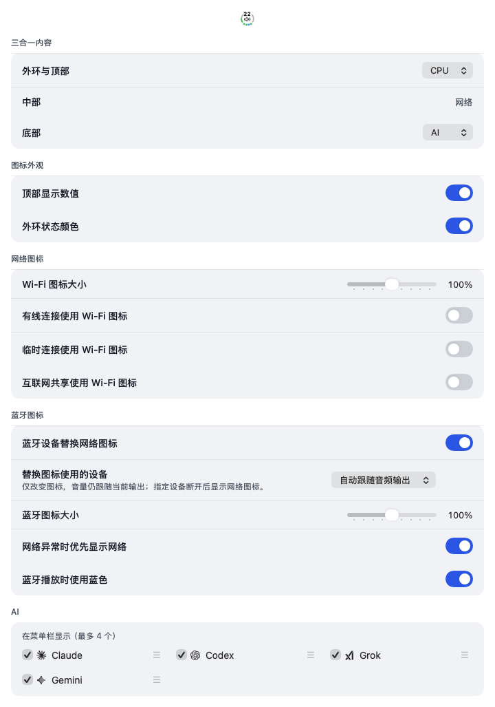
</p>
<p align="center">
  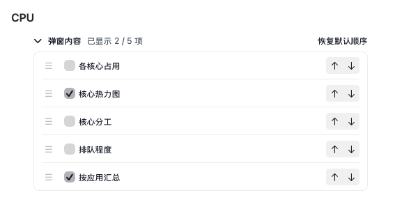
</p>
<p align="center">
  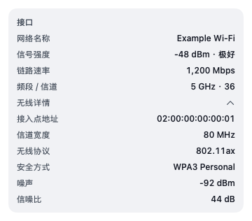
</p>
<p align="center">
  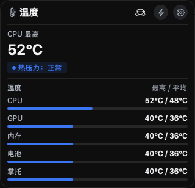
</p>
<p align="center">
  
</p>
<p align="center">
  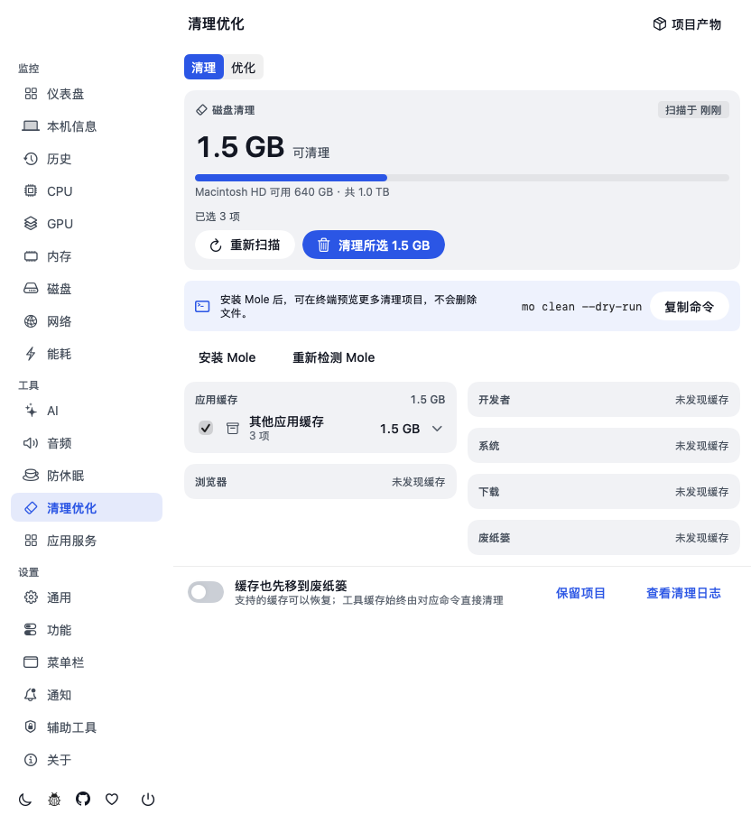
</p>
<p align="center">
  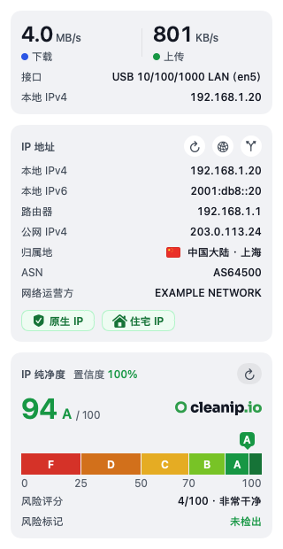
</p>
<p align="center">
  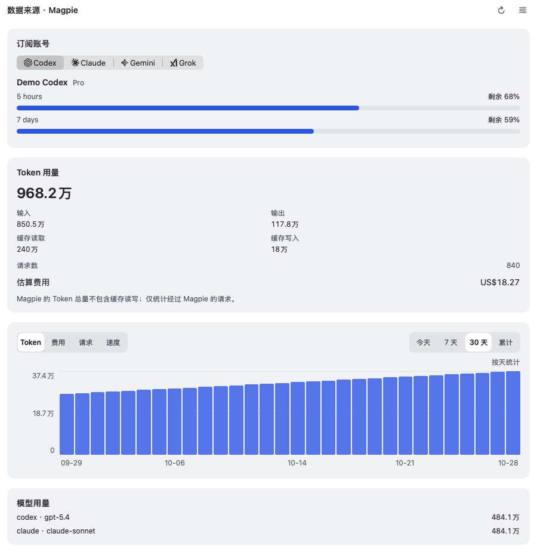
</p>
<p align="center">
  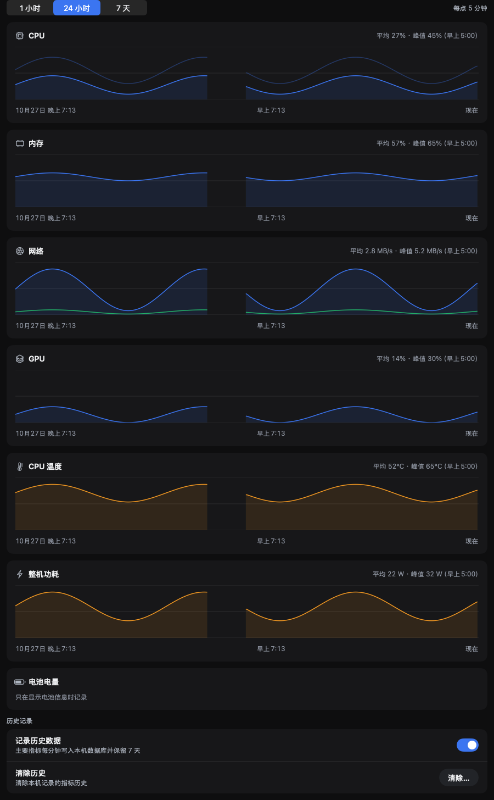
</p>
<p align="center">
  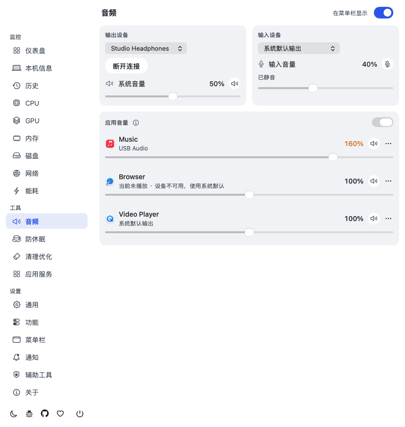
</p>
<p align="center">
  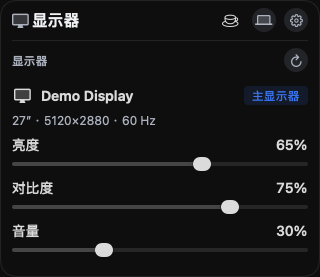
</p>
<p align="center">
  
</p>
<p align="center">
  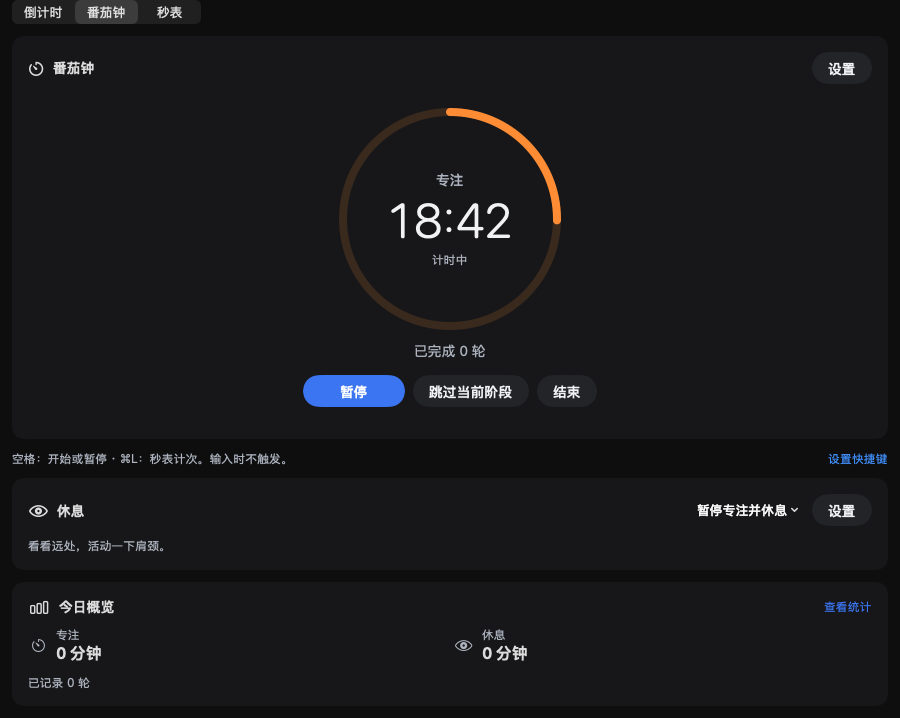
</p>

<p align="center">
  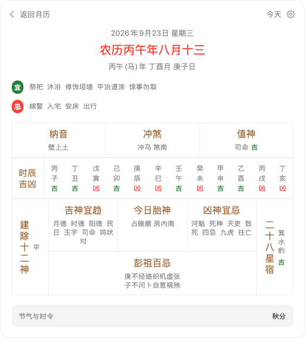
</p>

</details>

## 可选组件与权限

- **网络监视器**：按引导安装独立组件，需要管理员账户，并在 macOS 中批准系统扩展与网络过滤；组件独立更新 · [安装与升级说明](docs/DEVELOPMENT.md#网络连接试验模块)。
- **辅助工具**：风扇控制、合盖防休眠等特权操作需要安装并授权辅助工具。
- **Finder 新建文档**：需要在系统设置中启用 Finder 扩展 · [启用说明](docs/DEVELOPMENT.md#finder-新建文档)。
- **XStats Capture**：截图与录屏的授权范围见 [Capture 使用说明](docs/CAPTURE.md)。

原生清理先预览、选择并确认，按项目类型和设置移到废纸篓或直接删除。Mole 可不经预览直接确认执行，按自身规则永久清理，不沿用原生勾选、保留项或废纸篓设置。卸载需确认，使用废纸篓。

## 数据与隐私

监控数据、历史记录与 AI 用量在本机处理。

- **检查更新**：发送版本号与安装标识哈希，获取更新清单。
- **AI 用量**：通过 Magpie 本地接口读取额度与统计。
- **联网功能**：组件与地理数据库下载、网络诊断会连接相应服务；全球探针的测量目标与结果可能被他人查询。
- **菜单栏折叠**：macOS 27 实验功能，需要授权访问单个系统配置文件，以隐藏和恢复所选应用。

完整说明见[隐私政策](Packages/XStatsKit/Sources/XStatsUI/Resources/Legal/Privacy.zh-Hans.md)和[服务条款](Packages/XStatsKit/Sources/XStatsUI/Resources/Legal/Terms.zh-Hans.md)。

## 构建与贡献

欢迎提交 Issue 和 Pull Request。开发环境与发布流程见 [DEVELOPMENT.md](docs/DEVELOPMENT.md)，模块边界与实现约束见 [ARCHITECTURE.md](docs/ARCHITECTURE.md)。

## 版本记录

<!-- changelog:start -->
<!-- 由 scripts/sync_changelog.py 从 CHANGELOG.md 生成，请勿手改。 -->

最新版本 **1.6.2**（2026-11-09） · [完整更新日志](CHANGELOG.md)

<!-- changelog:end -->

## 致谢与许可

XStats 基于 [OpenStats](https://github.com/gentpan/OpenStats) 开发。感谢原项目及其他开源项目的贡献；来源、许可和版权信息见 [ThirdPartyNotices.md](ThirdPartyNotices.md)。XStats 是独立的第三方应用，与 Apple 及其他提及的公司没有隶属关系。

XStats 新增代码与修改采用 **AGPL-3.0-or-later**，见 [LICENSE](LICENSE) 和 [LICENSING.md](LICENSING.md)。OpenStats 上游代码保留原 [MIT 许可](LICENSES/OpenStats-MIT.txt)。
