<div align="center">

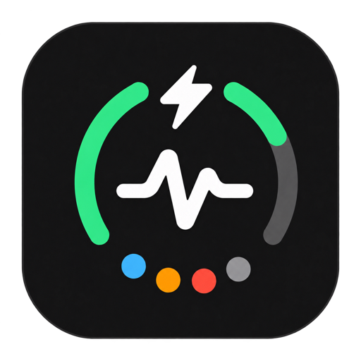

# XStats

**Mac 系统监控与常用工具，兼具主窗口和菜单栏体验。**

CPU、内存、网络与温度一眼可见，展开即可查看趋势与应用占用；AI、日历、风扇控制等工具按需启用。

[](https://github.com/ysicing/xstats/releases)
[](https://github.com/ysicing/xstats/actions/workflows/ci.yml)
[](https://github.com/ysicing/xstats/releases)
[](LICENSE)
[](https://twitter.com/YsiCing)

[下载最新版](https://github.com/ysicing/xstats/releases) · [功能](#功能) · [安装](#安装) · [数据与隐私](#数据与隐私) · [更新日志](CHANGELOG.md)

**简体中文** · [English](README.en.md) · [日本語](README.ja.md) · [한국어](README.ko.md)

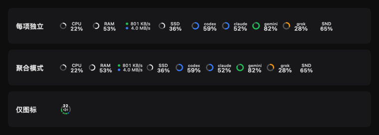

</div>

<p align="center">
  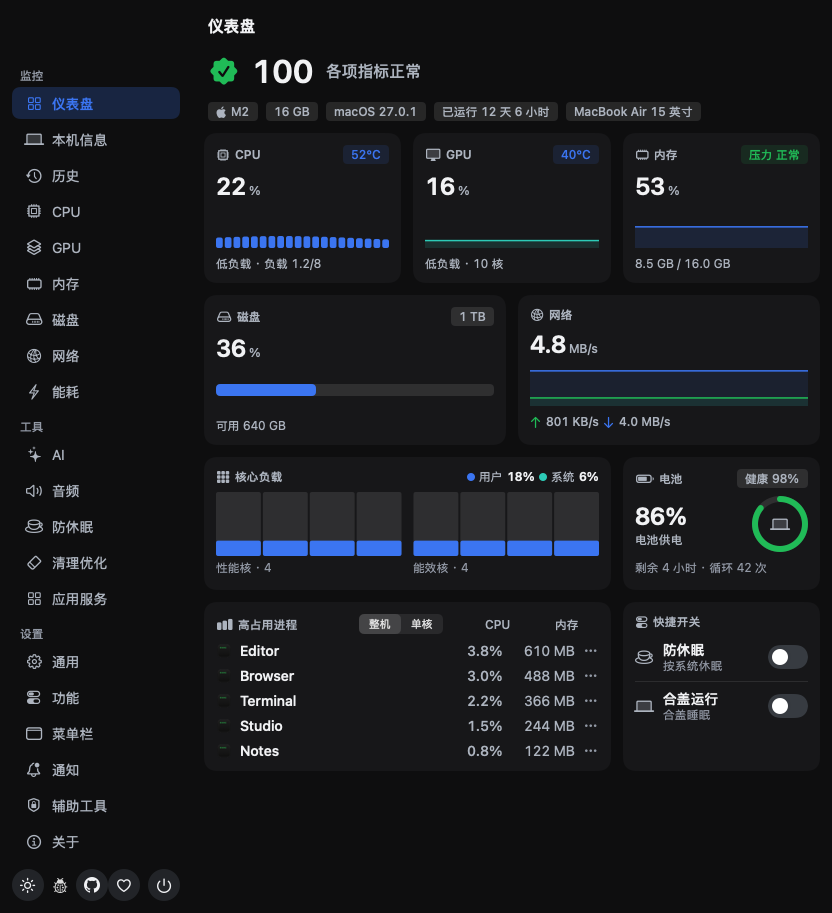
  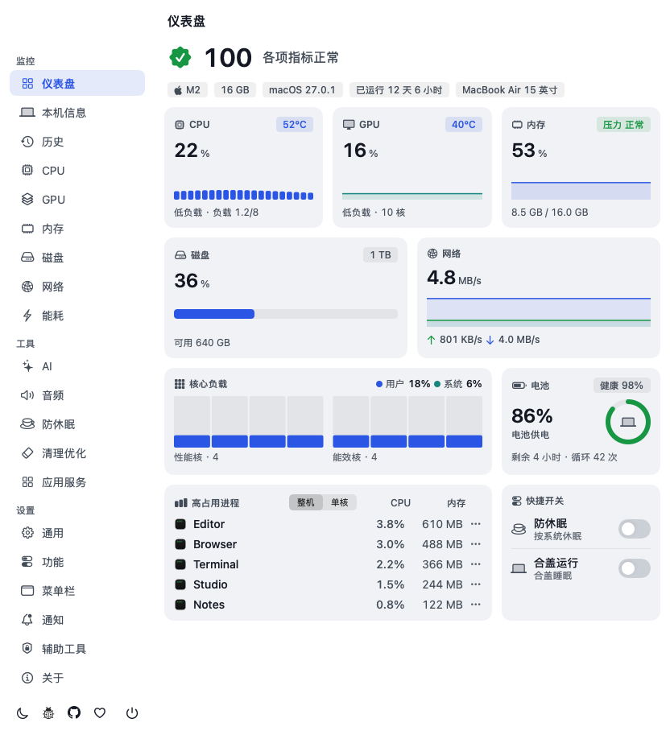
</p>

## 功能

XStats 使用 Swift、AppKit 与 SwiftUI 原生开发，免费开源，无需注册账号。

### 菜单栏布局

指标可**独立显示**、使用**聚合模式**，或合成一个内容自由搭配的**三合一图标**。仅图标模式下，程序坞图标同步显示相同的实时状态。显示项目、顺序与样式（文字、图标、圆环、进度条、历史图）均可自定义。

聚合模式可分别选择菜单栏与状态总览中的项目，在总览中集中查看指标并打开详情。

<p align="center">
  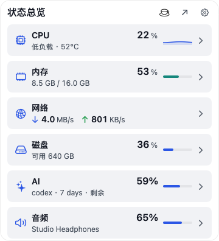
  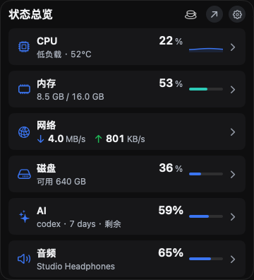
</p>

菜单栏布局与状态总览使用演示数据，便于展示不同布局与信息组合。

### 按需启用与菜单栏展示

在“设置 → 功能”中，基础监控与可选功能分别管理。

- **基础监控**：CPU、GPU、内存、磁盘、网络、能耗与风扇可分别关闭。关闭后停止实时采集、相关提醒和新增历史记录，基础信息、页面入口与已有历史保留；系统小组件仍独立刷新。
- **菜单栏展示**：除电池信息入口外，基础监控、AI 与音频勾选“在菜单栏显示”时，会同时启用对应功能；取消勾选只移除入口，不会关闭功能。AI 与音频也有独立的展示选项。
- **显示器参数控制**：只控制亮度、对比度与音量的读写。关闭后仍能查看显示器信息，并单独选择是否在菜单栏显示。

<p align="center">
  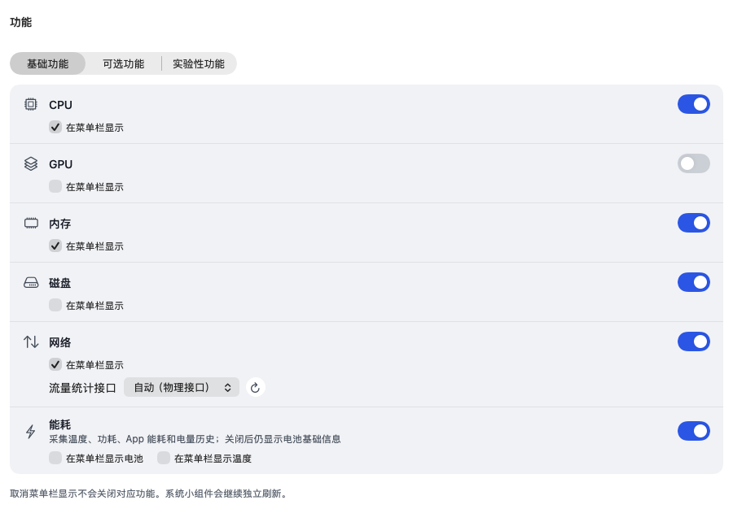
  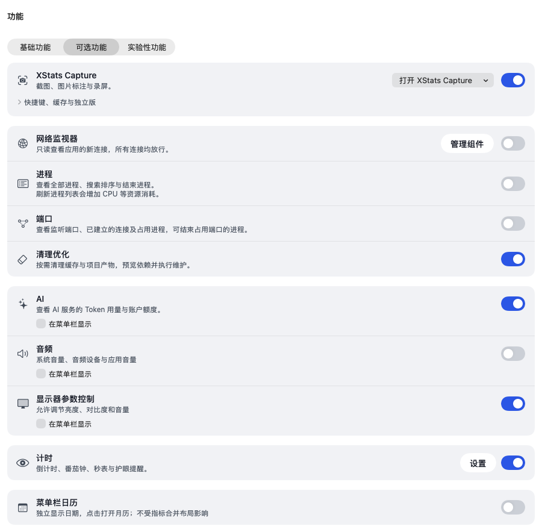
</p>

### 系统监控

| 模块 | 内容 |
|---|---|
| **CPU** | 用户 / 系统 / 空闲占用、逐核与核心组负载、负载平均、频率与温度、热压力提示 |
| **GPU** | 图形负载、核心数、温度与功耗 |
| **内存** | 内存压力、应用 / 压缩 / 缓存构成、交换空间与换入换出速率 |
| **磁盘** | 容量、读写速率、应用读写排行、SMART 健康信息 |
| **网络** | 上传 / 下载速率、网络接口与连接概况 |
| **能耗** | 温度、整机功耗、App CPU 能耗、阻止睡眠的应用、电池状态与蓝牙设备电量 |
| **风扇** | 转速与支持机型的调速控制 |
| **显示器** | 分辨率、缩放与刷新率；支持 DDC/CI 的外接屏可调节亮度、对比度与音量 |
| **系统信息** | 机型与系统标识；点击 Apple 智能旁的详情图标，查看功能配置状态、本机模型可用性与磁盘占用 |

频率、温度、功耗等读数取决于机型和系统是否提供。

<p align="center">
  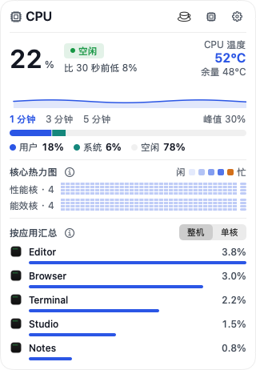
  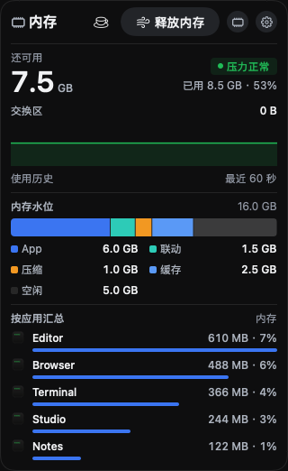
</p>

### 网络监视器

**macOS 15+ 的可选功能，默认关闭。** 查看观察期间的新连接，可按应用、进程、域名、国家或地域汇总，支持搜索、活动连接筛选、暂停与恢复。

- **只读**：全部连接放行，不读取通信内容，不保存连接历史。
- **按需运行**：仅在页面可见且未暂停时读取，内存中最多保留 512 条记录；不会枚举开始观察之前的全部连接。
- **世界地图**：首次使用时按需下载公共 IP 地理数据库，之后离线查询。位置是国家或地域的代表位置，不是设备精确位置。

首次使用：在“设置 → 功能 → 可选功能”启用网络监视器，按引导安装 XStats Network Monitor 组件，并在 macOS 中批准系统扩展与网络过滤。安装需要管理员账户。之后可通过“管理组件”检查独立更新或卸载组件。

使用过网络组件预览版的用户：先升级主程序，再通过“管理组件”卸载旧组件，按系统提示完成必要的重启后重新启用，以迁移到当前更新入口。

<p align="center">
  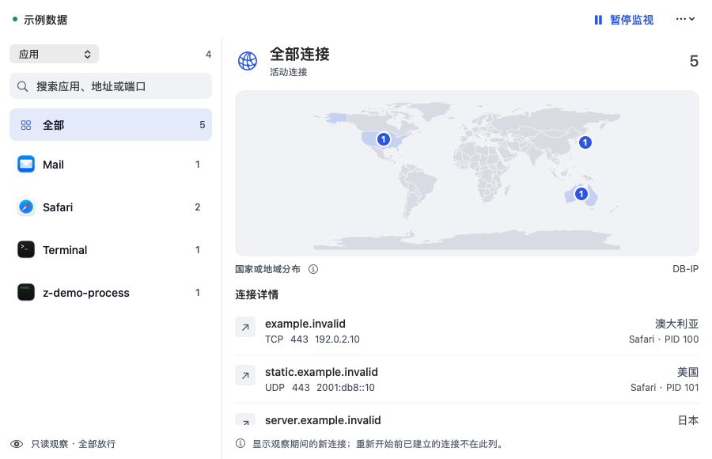
  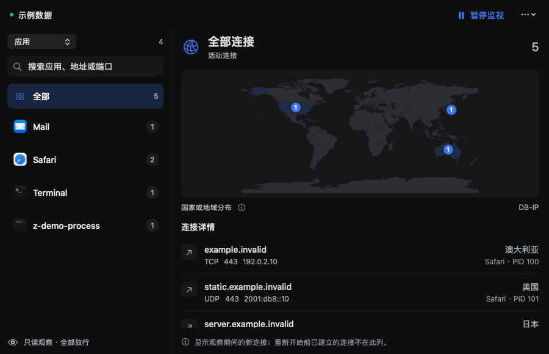
</p>

<p align="center">
  
  
</p>

连接、地址、国家或地域与组件版本信息均为演示数据。

### AI

在菜单栏查看 AI 服务用量：

- **用量走势**：查看今日、近 7 / 30 天及累计的 Token、费用、请求数与生成速度。
- **订阅账号**：各服务账号、套餐类型、额度使用情况与重置时间。
- **费用估算**：显示 Magpie 提供的美元费用估算，不代表订阅账单。

AI 用量仅支持 Magpie，需要安装并运行 Magpie。XStats 从其本地接口读取各账户额度、Token 与费用，支持 Grok 等 Magpie 已接入的服务；Token 仅统计经过 Magpie 的请求。

### 工具

| 工具 | 说明 |
|---|---|
| **XStats Capture** | 内置截图标注、本地打码与带声音的录屏；可单独[下载 Capture](https://github.com/ysicing/XStats/releases/tag/capture-v0.1.5)，详见 [Capture 使用说明](docs/CAPTURE.md) |
| **风扇控制** | 在支持的设备上切换自动或手动控制 |
| **防休眠** | 保持系统或屏幕唤醒，可配置合盖运行 |
| **应用服务** | 统一管理应用、Homebrew、启动项与 Homebrew 服务，查看应用信息和可用更新 |
| **清理优化** | 审阅缓存与项目产物，支持已安装的 Mole 引擎与执行日志，预览依赖并按需维护 · [清理范围](docs/CLEANUP.md) |
| **网络诊断** | 测速、DNS 查询、出口检测、本地接口与多来源公网 IP 查询、归属地与纯净度、连通性探测，以及内置 WebRTC / DNS 泄漏检测 |
| **菜单栏日历** | 农历、节假日与调休、黄历，以及系统日程和提醒事项 |
| **音频** | 系统音量与输入 / 输出设备切换；macOS 14.4+ 可按应用调节音量与输出，仅在本机处理 |
| **计时** | 倒计时、番茄钟与秒表；多屏休息幕布、迷你 HUD、独立护眼提醒与本机专注统计 |
| **进程管理** | 搜索、排序、按应用分组与结束进程 |

计时支持倒计时、番茄钟和秒表，支持随时短休或长休、休息时息屏，以及独立护眼提醒、休息声音与本机专注统计。

可选工具可按需启用。风扇控制、合盖防休眠等特权操作需要安装并授权辅助工具；清理与卸载会先预览并请求确认。原生清理按项目类型和设置移到废纸篓或直接删除；Mole 引擎按自身规则永久清理，不沿用原生勾选和保留项。卸载使用废纸篓。

<details>
<summary>更多截图</summary>

菜单栏布局、状态总览、Wi-Fi 详情、网络连接、AI 用量与额度、历史、音频、显示器和日程截图使用演示数据；其余系统监控截图包含本机只读采样。截图不代表所有机型都提供相同的硬件能力。

<p align="center">
  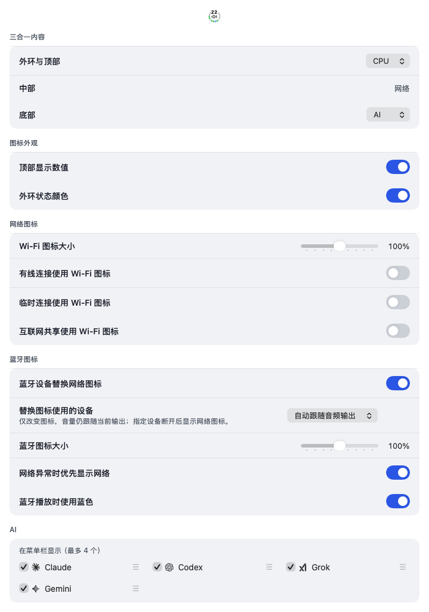
</p>
<p align="center">
  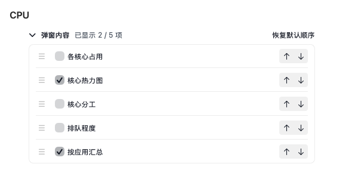
</p>
<p align="center">
  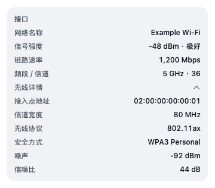
</p>
<p align="center">
  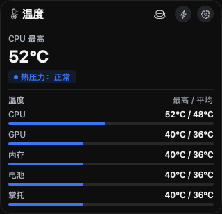
  
</p>
<p align="center">
  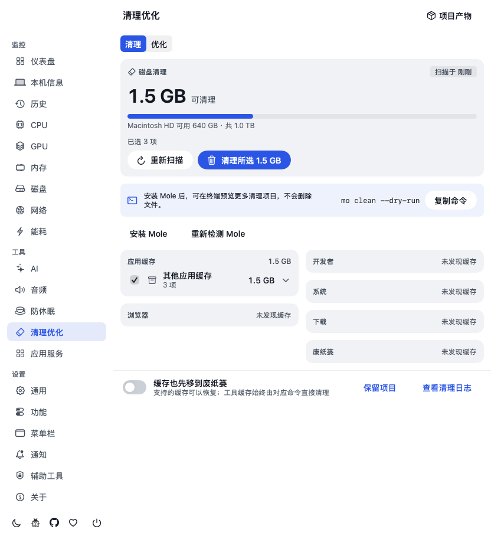
  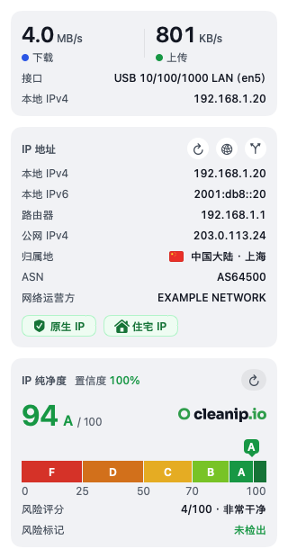
</p>
<p align="center">
  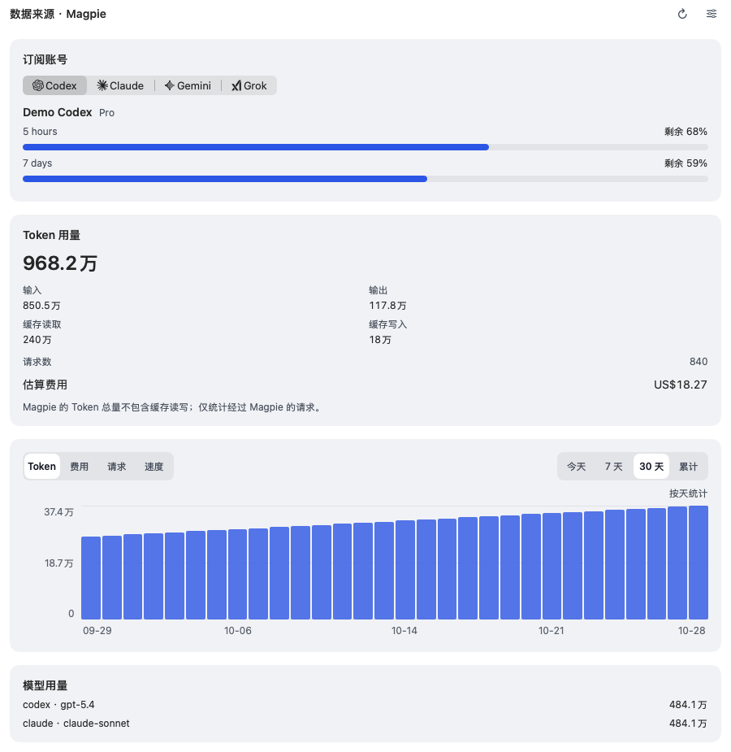
</p>
<p align="center">
  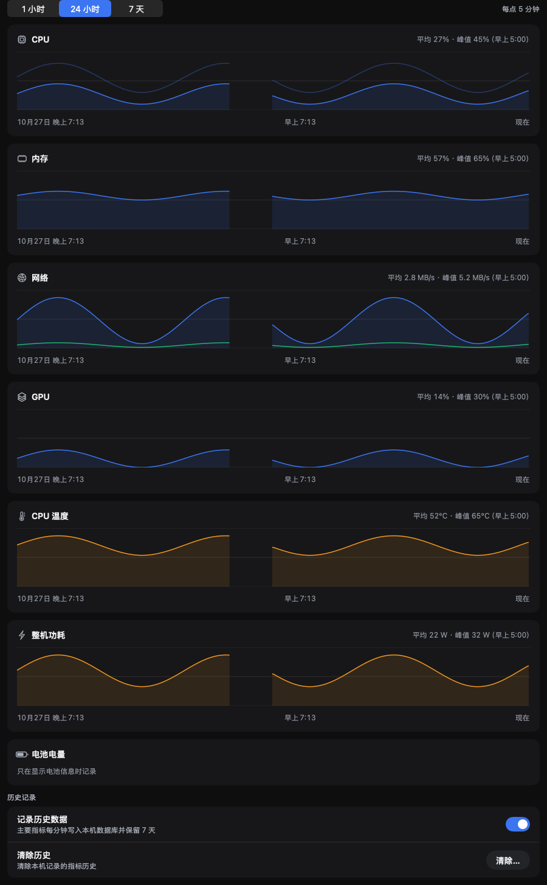
</p>
<p align="center">
  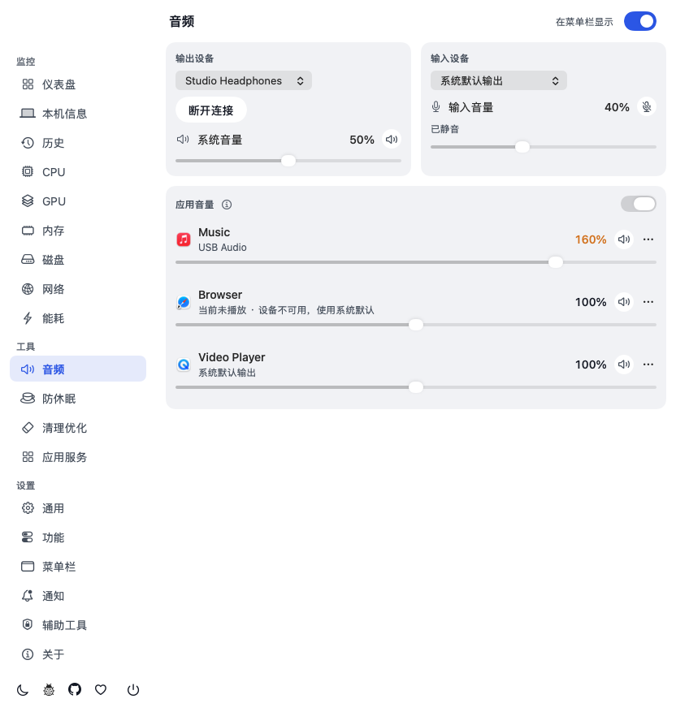
  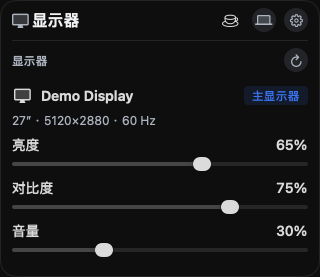
</p>
<p align="center">
  
  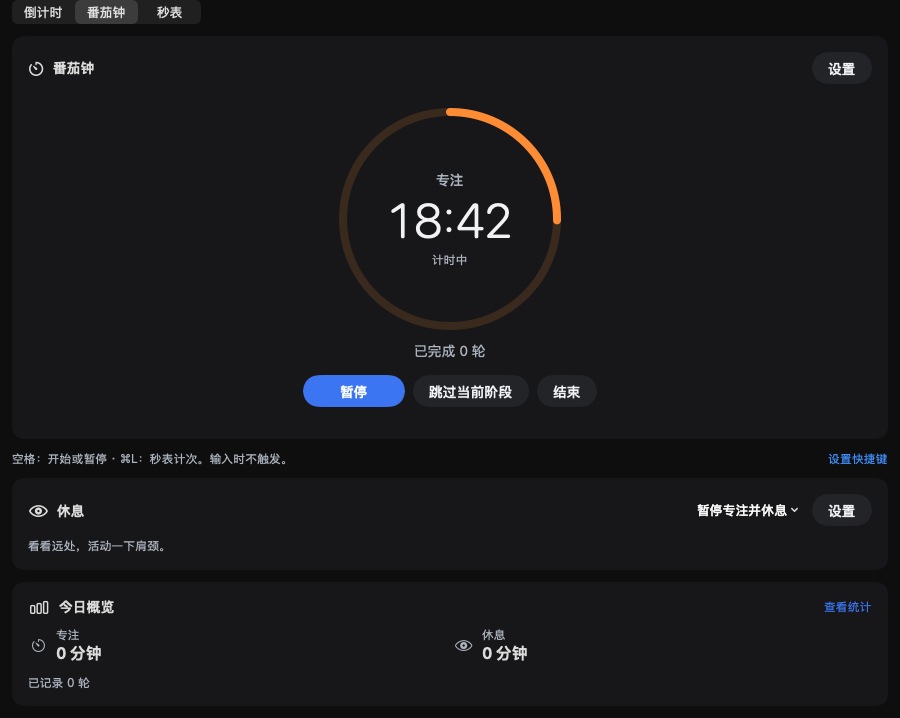
</p>

</details>

### 集成

- **桌面小组件**：系统概览、番茄钟、AI 额度与累计 Token、日历与整月日历、明天上班吗、IP 纯净度与公网 IP。
- **多语言**：简体中文、繁體中文、English、日本語、한국어、Deutsch、Español、Français、العربية。
- **深链**：通过 `xstats://` 从启动器、快捷指令或终端打开常用入口；已关闭的模块会转到设置，不会被隐式启用。

```bash
open 'xstats://open/connections'   # 打开网络监视器
open 'xstats://panel/cpu'          # 显示 CPU 弹窗
```

完整路径与操作见[深链协议](docs/DEVELOPMENT.md#xstats-深链)。

## 安装

需要 **Apple 芯片 Mac 与 macOS 14 或更新版本**。

```bash
brew tap ysicing/tap
brew trust ysicing/tap
brew install --cask xstats
```

也可从 [GitHub Releases](https://github.com/ysicing/xstats/releases) 下载 DMG，将 XStats 拖入“应用程序”。应用内置更新检查，是否安装新版本由你决定。

## 数据与隐私

监控数据、本机历史与 AI Token 统计均在本机处理，不上传到 XStats 更新服务。以下功能会连接外部服务，可关闭或按需使用：

- **检查更新**：主程序、独立网络组件和独立 Capture 发送各自版本与安装标识的哈希，获取更新清单。
- **AI**：只连接 Magpie 本地接口读取额度与统计，不读取 CLI 凭据或会话日志。
- **网络监视器**：下载组件及公共地理数据库时联网；连接记录和目标 IP 不上传。
- **网络诊断**：公网 IP、归属地、测速、DNS、连接探测与全球探针会请求相应服务；全球探针的测量目标与结果可能被他人查询。

macOS 27 的实验性菜单栏折叠需授权访问单个系统配置文件，用于隐藏和恢复所选应用；无需屏幕录制，应用列表不上传。

完整说明见[隐私政策](Packages/XStatsKit/Sources/XStatsUI/Resources/Legal/Privacy.zh-Hans.md)和[服务条款](Packages/XStatsKit/Sources/XStatsUI/Resources/Legal/Terms.zh-Hans.md)。

## 构建与贡献

需要 Xcode 26+、Go 1.25+、[Go Task](https://taskfile.dev/) 和 [XcodeGen](https://github.com/yonaskolb/XcodeGen)：

```bash
task test
task build BUMP=0 INSTALL=0
```

欢迎提交 Issue 和 Pull Request。开发环境与发布流程见 [DEVELOPMENT.md](docs/DEVELOPMENT.md)，模块边界与实现约束见 [ARCHITECTURE.md](docs/ARCHITECTURE.md)。

## 版本记录

<!-- changelog:start -->
<!-- 由 scripts/sync_changelog.py 从 CHANGELOG.md 生成，请勿手改。 -->

最新版本 **1.4.11**（2026-10-28） · [完整更新日志](CHANGELOG.md)

<!-- changelog:end -->

## 致谢与许可

XStats 基于 [OpenStats](https://github.com/gentpan/OpenStats) 开发。感谢原项目及其他开源项目的贡献；来源、许可和版权信息见 [ThirdPartyNotices.md](ThirdPartyNotices.md)。XStats 是独立的第三方应用，与 Apple 及其他提及的公司没有隶属关系。

XStats 新增代码与修改采用 **AGPL-3.0-or-later**，见 [LICENSE](LICENSE) 和 [LICENSING.md](LICENSING.md)。OpenStats 上游代码保留原 [MIT 许可](LICENSES/OpenStats-MIT.txt)。
